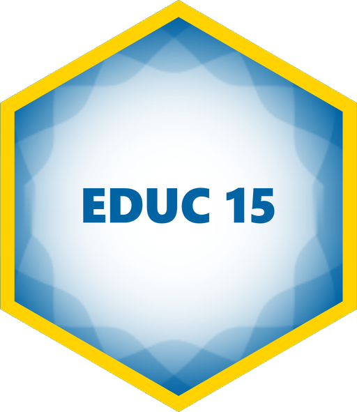

<!-- README.md is generated from README.qmd. Please edit that file -->

# Statistics for Education Research 

[EDUC 15 • Winter 2027](https://educ15.de-barros.com/)  [Andreas de
Barros](https://www.de-barros.com/) • School of Education • University
of California, Irvine

------------------------------------------------------------------------

**[Quarto](https://quarto.org/) +
[{targets}](https://docs.ropensci.org/targets/) +
[{renv}](https://rstudio.github.io/renv/) +
[{xaringan}](https://github.com/yihui/xaringan)**

------------------------------------------------------------------------

## How to build the site

1.  Open `educ15.Rproj` in RStudio. You need
    [Quarto](https://quarto.org/) 1.10 or later.
2.  Run `renv::restore()` in the R console to install the packages.
3.  Run `targets::tar_make()` to build everything. The site ends up in
    `_site/`.

## Data

Most examples use data from the Mindspark study ([Muralidharan, Singh,
and Ganimian 2019](https://doi.org/10.1257/aer.20171112)). The files
used in class are in [`files/data/mindspark/`](files/data/mindspark/),
with a README giving their source and what we changed. The [data
page](https://educ15.de-barros.com/resource/data.html) has the same
files. The authors’ originals are in their [replication package on
openICPSR](https://doi.org/10.3886/E113192V2).

## Licenses

**Text and figures:** All prose and images are licensed under Creative
Commons ([CC-BY-NC
4.0](https://creativecommons.org/licenses/by-nc/4.0/)).

**Code:** All code is licensed under the [MIT License](LICENSE.md).

**Data:** The Mindspark data in `files/data/mindspark/` are © 2019
American Economic Association and licensed under [CC BY
4.0](https://creativecommons.org/licenses/by/4.0/), not the licenses
above.

## Credits

The site design is adapted from [Andrew
Heiss](https://www.andrewheiss.com/)’s course sites.

The [course simulator](simulator/) was written for EDUC 15. It was
inspired by the visualizations of [Kristoffer
Magnusson](https://rpsychologist.com/) at [R
Psychologist](https://rpsychologist.com/viz/), including
[p-values](https://rpsychologist.com/pvalue/), [statistical
power](https://rpsychologist.com/d3/NHST/), [confidence
intervals](https://rpsychologist.com/d3/CI/) and
[correlation](https://rpsychologist.com/correlation/).
