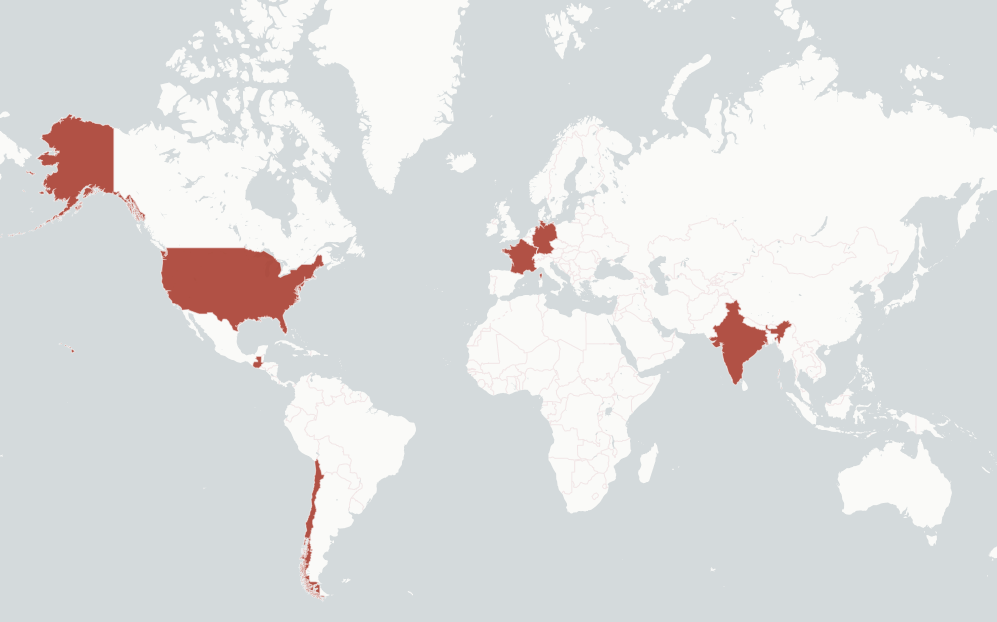
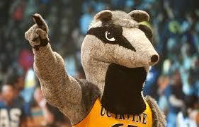
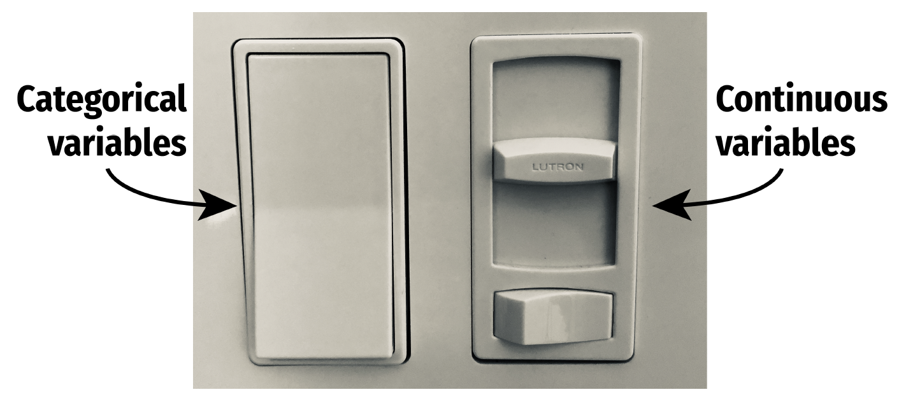

```{r setup, include=FALSE}
knitr::opts_chunk$set(warning = FALSE, message = FALSE, echo = FALSE,
                      fig.retina = 3, fig.align = "center",
                      dev = "ragg_png")  # ragg finds Fira Sans Condensed on Windows
```

```{r packages-data, include=FALSE}
library(tidyverse)
library(knitr)
source(here::here("R", "slide-things.R"))

# Colors from the slide theme, all readable on white ----
clr_bar <- "#538ba2"
clr_soft <- "#c5d9e2"
clr_mean <- "#a93e31"
clr_median <- "#244a70"
clr_mode <- "#8a6100"

theme_slides <- function(base_size = 20) {
  theme_minimal(base_size = base_size, base_family = "Fira Sans Condensed") +
    theme(panel.grid.minor = element_blank(),
          panel.grid.major.x = element_blank(),
          axis.title = element_text(face = "bold"),
          strip.text = element_text(face = "bold", size = rel(1)))
}

fmt <- function(x, d = 2) formatC(x, format = "f", digits = d)

# Points in the course, as decided for 2027 ----
points <- tribble(
  ~What, ~Points, ~`How it counts`, ~in_person,
  "Quizzes", 40, "Best 4 of 5 Friday events, 10 points each", TRUE,
  "Labs", 21, "Best 7 of 10 labs, 3 points each", TRUE,
  "Mastery Training", 40, "Best 8 of 9, 5 points each", FALSE,
  "Problem Sets", 40, "Best 8 of 9, 5 points each", FALSE,
  "Midterm", 100, "In person", TRUE,
  "Final", 100, "In person, cumulative", TRUE,
  "Course evaluation", 9, "For completing it", FALSE
)
points_total <- sum(points$Points)
points_person <- sum(points$Points[points$in_person])
stopifnot(points_total == 350)

# The Mindspark study ----
baseline <- read_csv(here::here("files", "data", "mindspark", "ms_blel_jpal_baseline.csv"),
                     show_col_types = FALSE)
endline <- read_csv(here::here("files", "data", "mindspark", "ms_blel_jpal_endline.csv"),
                    show_col_types = FALSE)
math <- baseline$tot_math
n_all <- length(math)
n_end <- nrow(endline)
n_centers <- n_distinct(baseline$ms_center1)
n_treat <- sum(baseline$treat == 1)
n_control <- sum(baseline$treat == 0)
pct_grade69 <- 100 * mean(baseline$st_grade1 %in% 6:9)
pct_female <- 100 * mean(baseline$st_female1 == 1)

end_means <- endline %>%
  group_by(treat) %>%
  summarize(m = mean(tot_math))
end_treat <- end_means$m[end_means$treat == 1]
end_control <- end_means$m[end_means$treat == 0]

# Treat the 619 students as a population, and draw samples of 25 ----
mu <- mean(math)
set.seed(15)
draws <- tibble(id = 1:20, m = map_dbl(1:20, ~ mean(sample(math, 25))))
two_means <- draws$m[1:2]

# Four scales in the same data ----
ses_range <- range(baseline$ses_index)
tuition_levels <- c("Less than 1 hour", "More than 4 hours")

quintile_means <- baseline %>%
  filter(!is.na(quint_math1)) %>%
  group_by(quint_math1) %>%
  summarize(m = mean(tot_math))
quintile_gaps <- diff(quintile_means$m)

# Four students, to show what a variable is ----
four_rows <- baseline %>%
  slice(c(1, 200, 245, 100)) %>%
  transmute(Center = ms_center1,
            Grade = st_grade1,
            Group = if_else(treat == 1, "Treatment", "Control"),
            `Math score` = tot_math)
```

```{r xaringanExtra, echo=FALSE}
xaringanExtra::use_xaringan_extra(c("tile_view"))
```

class: center middle main-title section-title-4

# Introduction and measurement

.class-info[

**Topic 1 · Tuesday, January 5**

.light[EDUC 15: Statistics for Education Research<br>
UCI School of Education
]

]

---

name: outline
class: title title-8

# Plan for today

.box-1.medium.sp-after-half[Welcome!]

.box-6.medium.sp-after-half[What statistics is for]

.box-3.medium.sp-after-half[Measurement]

???

Three blocks of about 20 minutes. Each ends with students doing something: play, predict, try.

---

layout: false
class: center middle section-title section-title-1 animated fadeIn

# Welcome!

---

layout: true
class: title title-1

---

# Please call me Andy

.pull-left[
.box-1.medium[Andreas de Barros]

.portrait[]

.center[
Lectures

[Student hours on Calendly](https://calendly.com/de-barros/student-hours-andy-de-barros)

[adb@uci.edu](mailto:adb@uci.edu)
]
]

.pull-right[
.box-inv-1.medium[TA: Pritha Sengupta]

.center[
Friday labs

Drop-in student hours

[prithas@uci.edu](mailto:prithas@uci.edu)
]
]

---

class: title title-1 long-title one-line

# Shout out to all those here who find this place a bit strange

.map-left[
.picture[]
]

.map-right[
```{r path-table, results="asis"}
tribble(
  ~Where, ~What,
  "Germany", "BA and MA in Political Science, and teacher training, at Konstanz University",
  "Guatemala", "An education NGO in Ciudad de Guatemala",
  "France", "International education policy at UNESCO",
  "Chile, India and the US", "Education research at J-PAL and at MIT",
  "US", "PhD in Education at Harvard University"
) %>%
  kable(format = "html", table.attr = 'class="deck-table tight"')
```
]

???

The personal note. Say this your own way: nobody here should feel they have to already belong.

---

class: title title-1 long-title

# My work promotes large-scale research-practice partnerships, particularly in Sub-Saharan Africa and South Asia

.box-inv-1.tiny-box[Educational technology]

```{r work-edtech, results="asis"}
tribble(
  ~Size, ~Partners,
  "240 government schools", "State Government of Haryana, Avanti Fellows, USAID DIV",
  "250 early-childhood centers", "State Government of Uttarakhand, Dost Education, The Agency Fund",
  "30 government schools", "State Government of Rajasthan, Educational Initiatives, Douglas B. Marshall Foundation"
) %>%
  kable(format = "html", table.attr = 'class="deck-table tight work"')
```

.box-inv-1.tiny-box[Assisting teachers in adjusting and improving their instruction]

```{r work-teachers, results="asis"}
tribble(
  ~Size, ~Partners,
  "292 government schools", "State Government of Karnataka, Akshara Foundation, Omidyar",
  "209 government schools", "Cambodia Ministry of Education, Youth and Sport, The World Bank",
  "273 government schools", "Zambia Ministry of Education, TaRL Africa, VVOB, KIX",
  "500+ government schools", "Morocco Ministry of National Education, Pratham, J-PAL, Harvard"
) %>%
  kable(format = "html", table.attr = 'class="deck-table tight work"')
```

---

# What you'll take from this course

.box-1.medium.sp-after-half[Read and explain statistics in education research]

.box-inv-1.medium.sp-after-half[Describe and define the key ideas]

.box-inv-1.medium.sp-after-half[Do the calculations]

.box-1.small[We build intuition first: you'll run simulations, and always ask what's the truth and what's only our estimate]

???

Every week comes back to the same question: is this number a fact about the population, or our estimate of it?

---

# Your week has a routine

```{r week-table, results="asis"}
tribble(
  ~When, ~What, ~Where,
  "Before class", "Do the reading", "The book, through MindTap",
  "Tue and Thu, 12:30–1:50 PM", "Lecture: 20 minutes of talk, then you do something, three times", "EDUC 2009",
  "Fri, 12:00–12:50 PM", "Lab A1", "EDUC 2009",
  "Fri, 1:00–1:50 PM", "Lab A2", "EDUC 2001",
  "Sun, 6 PM", "MindTap homework is due", "Canvas"
) %>%
  kable(format = "html", table.attr = 'class="deck-table"')
```

.box-1.small[Go to all classes. Go to your own lab. Lecture activities aren't scored]

???

Andy: confirm rooms and times on WebSOC.

---

# Fridays: six regular labs, four quiz days

.pull-left[
.box-1.small[Regular labs]

.small[
A by-hand problem in pairs

The same idea on real data, in a spreadsheet or the simulator

One written sentence on what it means
]
]

.pull-right[
.box-1.small[Quiz days]

.small[
A quiz in Labs 3, 5, 8 and 10

Labs 5 and 10 also review for the exams

We'll explain the format in class
]
]

.box-inv-1.small[Lab 2 has a 15-minute individual check. Use Google Sheets or Excel]

???

Four quizzes plus the Lab 2 check make the five Friday events. Go to your own lab. No R for students.

---

# It adds up to `r points_total` points

```{r points-table, results="asis"}
points %>%
  select(-in_person) %>%
  kable(format = "html", align = "lcl", table.attr = 'class="deck-table tight"')
```

.box-1.small[You earn `r points_person` of the `r points_total` points in person. Lecture attendance isn't graded]

???

A lab's 3 points are for being there and handing in a real attempt at the sentence, not for being correct. Quiz days earn them for being there.

---

# Two exams, both in person

.pull-left[
.box-1.small[Midterm]

.small[
Thursday, February 11, in class

80 minutes, Chapters 1 to 9
]
]

.pull-right[
.box-1.small[Final]

.small[
Date to come from the Registrar

Cumulative
]
]

.box-inv-1.small.sp-after-half[Each is 100 points of free response, built on the Mindspark data]

.box-inv-1.small.sp-after-half[Bring a calculator, and no other device. We attach tables and a formula sheet]

.box-inv-1.small[You can ask for a translated exam, in any language]

???

Exams use an outcome students haven't seen in class. Andy: add the final's date once WebSOC has it, and the date to ask for a translation by.

---

# Homework is due Sundays at 6 PM

.pull-left[
.box-1.small[Mastery Training]

.small.center[
Unlimited attempts
]
]

.pull-right[
.box-1.small[Problem Sets]

.small.center[
3 attempts, full credit at 75%
]
]

.box-inv-1.small.sp-after-half[Chapters 5 to 12 and 14. The first set is due Sunday, January 17]

.box-inv-1.small.sp-after-half[No extensions: your lowest score of each type drops, which covers emergencies]

.box-1.small[Get access to Cengage MindTap now, through Canvas]

???

There are 9 of each type. MindTap is practice: the Friday lab's by-hand problem is what looks like the exams.

---

# Use AI to learn, not to get answers

.pull-left[
.box-1.small[You're welcome to use AI to]

.small[
Explain an idea

Make practice problems

Help with a spreadsheet formula
]
]

.pull-right[
.box-1.small[Don't use it to]

.small[
Get answers to MindTap questions
]

.box-inv-1.small[Homework is your practice for exams and quizzes, where you'll have no AI and no devices]
]

.box-inv-1.small.sp-after-half[AI also makes mistakes in statistics, so check what it tells you]

.center.small[UCI's academic integrity rules still apply]

???

The full wording is in the syllabus. There's no take-home writing in this course, so this replaces the old Composition Program wording.

---

# Where to find things

.pull-left[
.box-1.small[Course website]

.small.center[
[educ15.de-barros.com](https://educ15.de-barros.com)

Syllabus, schedule, slides, lab handouts
]
]

.pull-right[
.box-1.small[Canvas]

.small.center[
MindTap and the ebook

Grades, solutions, and slide files
]
]

.box-inv-1.medium[Not sure about a rule? It's in the syllabus]

---

# It's in the syllabus

.picture[]

.source["Piled Higher and Deeper" by Jorge Cham, [www.phdcomics.com](https://phdcomics.com/comics.php?f=1583)]

---

# Most importantly

.box-1.medium.sp-after-half[Ask for help, and tell us how you're doing]

.box-inv-1.medium.sp-after-half[Check yourself before you wreck yourself]

.center.small[(Sorry, Ice Cube)]

.box-inv-1.small[Not sure about your math? Try the Math Skills Assessment in Appendix A]

---

layout: false
class: title title-8

# Play it: Course rules

.box-inv-8.small.sp-after-half[In Jeopardy, the clue is an answer. Talk to a neighbor, then call out the question]

.options.clues[
.option[
**100** · Sunday at 6 PM
]
.option[
**200** · 7 of 10
]
.option[
**300** · A calculator, and no other device
]
.option[
**400** · Explain an idea, but not a MindTap answer
]
]

???

About 6 minutes. Nothing is scored.

---

class: title title-8

# Play it: The questions

.options.clues[
.option[
**100** · When is homework due?
]
.option[
**200** · How many labs count?
]
.option[
**300** · What device can you use on an exam?
]
.option[
**400** · What can AI do for you?
]
]

.box-8.small[That's the rhythm of every lecture: some talk, then your turn]

---

layout: false
class: center middle section-title section-title-6 animated fadeIn

# What statistics is for

---

class: title title-8

# Where are we?

.pull-left-3[
.box-1.medium[Description]

.box-inv-1.small[Summarize data]

.box-inv-1.small[Visualize data]

.center[**We start here**]

.anteater[]
]

.pull-middle-3[
.box-6.medium[Prediction]

.box-inv-6.small[Forecast the future]

.box-inv-6.small[Focus is on Y]
]

.pull-right-3[
.box-3.medium[Explanation]

.box-inv-3.small[Effect of X on Y]

.box-inv-3.small[Focus is on X]
]

.source[Peter the Anteater at a UC Irvine basketball game.]

???

This map opens every topic. Statistics does three jobs, and we'll work through them in this order.

---

layout: true
class: title title-6

---

# One topic, three kinds of question

```{r purposes-table, results="asis"}
tribble(
  ~` `, ~Description, ~Prediction, ~Explanation,
  "Netflix", "Which movie was watched most?", "What's your next show?", "What's the effect of the time of day on what you pick?",
  "SNAP", "What % of students are eligible?", "Who will enroll?", "What's the effect of SNAP on poverty?"
) %>%
  kable(format = "html", table.attr = 'class="deck-table"')
```

.box-6.small[Before you pick a method, ask which of the three you're trying to do]

???

Ask students for a third row from their own lives.

---

class: title title-6 long-title one-line

# Prediction focuses on Y. Explanation focuses on one X

```{r venn-plot, fig.width=11, fig.height=4.8, out.width="92%", fig.alt="Two diagrams of overlapping circles. On the left, a circle for the next show on Netflix overlaps five circles labeled X1 to X5, which together cover most of it. On the right, a very large circle for poverty barely touches a small circle for a program, and only the thin sliver where they overlap is highlighted and labeled as its effect."}
circle <- function(x0, y0, r, id) {
  tibble(angle = seq(0, 2 * pi, length.out = 200),
         x = x0 + r * cos(angle), y = y0 + r * sin(angle), id = id)
}

panels <- c("Prediction: explain as much of Y as you can",
            "Explanation: get that little sliver right")

ring <- tibble(angle = seq(90, 378, by = 72) * pi / 180,
               x = 1.55 * cos(angle), y = 1.55 * sin(angle), id = paste0("X", 1:5))

venn_left <- bind_rows(map(1:5, ~ circle(ring$x[.x], ring$y[.x], 0.95, ring$id[.x]))) %>%
  mutate(panel = panels[1])

venn_right <- bind_rows(circle(0, 0, 2.1, "Y"), circle(2.3, 0, 0.45, "X")) %>%
  mutate(panel = panels[2])

venn_y <- circle(0, 0, 1.3, "Y") %>% mutate(panel = panels[1])

# The sliver is bounded by one arc of each circle
big <- 2.1
small <- 0.45
gap <- 2.3
cross <- (gap^2 + big^2 - small^2) / (2 * gap)
half <- sqrt(big^2 - cross^2)
arc_big <- seq(-asin(half / big), asin(half / big), length.out = 40)
arc_small <- seq(pi - asin(half / small), pi + asin(half / small), length.out = 40)
sliver <- tibble(x = c(big * cos(arc_big), gap + small * cos(arc_small)),
                 y = c(big * sin(arc_big), small * sin(arc_small)),
                 panel = panels[2])

venn_labels <- tribble(
  ~x, ~y, ~label, ~panel,
  0, 0, "Y: Next show\non Netflix", panels[1],
  0, 0, "Y: Poverty", panels[2],
  3, -0.72, "X: A program", panels[2]
) %>%
  bind_rows(mutate(ring, x = 1.95 * cos(angle), y = 1.95 * sin(angle), label = id, panel = panels[1])) %>%
  mutate(panel = factor(panel, levels = panels))

venn_all <- bind_rows(venn_left, venn_right) %>% mutate(panel = factor(panel, levels = panels))
venn_y <- mutate(venn_y, panel = factor(panel, levels = panels))
sliver <- mutate(sliver, panel = factor(panel, levels = panels))

ggplot() +
  geom_polygon(data = venn_all, aes(x = x, y = y, group = id), fill = clr_soft, alpha = 0.55,
               color = clr_median, linewidth = 0.7) +
  geom_polygon(data = venn_y, aes(x = x, y = y), fill = "white", alpha = 0.75,
               color = clr_median, linewidth = 1) +
  geom_polygon(data = sliver, aes(x = x, y = y), fill = clr_mean) +
  geom_text(data = venn_labels, aes(x = x, y = y, label = label), lineheight = 0.9,
            size = 6, fontface = "bold", color = "#1f2933", family = "Fira Sans Condensed") +
  geom_segment(data = tibble(panel = factor(panels[2], levels = panels)),
               aes(x = 2.75, xend = 2.05, y = 0.95, yend = 0.2), color = clr_mean, linewidth = 0.9) +
  geom_text(data = tibble(x = 3, y = 1.15, label = "Its effect", panel = factor(panels[2], levels = panels)),
            aes(x = x, y = y, label = label), size = 6, fontface = "bold", color = clr_mean,
            family = "Fira Sans Condensed") +
  facet_wrap(vars(panel), nrow = 1) +
  coord_equal(xlim = c(-2.85, 3.9), ylim = c(-2.85, 2.85)) +
  theme_void(base_size = 19, base_family = "Fira Sans Condensed") +
  theme(strip.text = element_text(face = "bold", margin = margin(b = 6)))
```

.source[Adapted from Andrew Heiss's slides.]

???

Left: Netflix doesn't care which X matters, as long as the guess is good. Right: poverty has many causes, and the program explains only a sliver of it. The whole job is getting that sliver right.

---

# Meet Mindspark, our running example

.box-6.small.sp-after-half[Adaptive learning software in after-school centers in Delhi, India]

.pull-left-3[
.box-inv-6.medium[`r n_all`]

.center.small[students]
]

.pull-middle-3[
.box-inv-6.medium[`r n_centers`]

.center.small[centers]
]

.pull-right-3[
.box-inv-6.medium[`r round(pct_grade69)`%]

.center.small[in grades 6 to 9]
]

.box-6.small[You'll work with the real data in labs and on both exams]

.source[Data: Muralidharan, Singh, and Ganimian (2019).]

???

`r round(pct_female)`% of the students are girls. Their math and Hindi were tested before the program ("baseline") and after it ("endline").

---

# A lottery decided who got it

.pull-left[
.box-6.small[Treatment]

.center.small[`r n_treat` students got the program]

.box-inv-6.medium[`r fmt(end_treat)`]

.center.small[average math score at endline]
]

.pull-right[
.box-6.small[Control]

.center.small[`r n_control` students were promised it later]

.box-inv-6.medium[`r fmt(end_control)`]

.center.small[average math score at endline]
]

.box-6.small[Is a gap of `r fmt(end_treat - end_control)` points real, or just luck? By March, you'll be able to say]

.source[Data: Muralidharan, Singh, and Ganimian (2019). Endline: `r n_end` students.]

???

Here's the hook for the quarter. This is explanation: X is the program and Y is the math score, and the lottery is why we can read it as an effect.

---

# From population to sample, and back

```{r cycle-plot, fig.width=10, fig.height=4.4, out.width="84%", fig.alt="A cycle of four arrows. From the population, all the people we care about, an arrow leads to the step of selecting a sample. The next arrow leads to the sample, the people in the study. The next leads to the step of generalizing the results, and the last arrow returns to the population."}
cycle_text <- tribble(
  ~x, ~y, ~label, ~face,
  0, 1, "The population\nAll the people we care about", "bold",
  1.05, 0, "We select\na sample", "plain",
  0, -1, "The sample\nThe people in our study", "bold",
  -1.05, 0, "We generalize\nthe results", "plain"
)

cycle_arrows <- tribble(
  ~x, ~y, ~xend, ~yend,
  0.56, 0.86, 1.02, 0.28,
  1.02, -0.28, 0.56, -0.86,
  -0.56, -0.86, -1.02, -0.28,
  -1.02, 0.28, -0.56, 0.86
)

ggplot() +
  geom_curve(data = cycle_arrows, aes(x = x, y = y, xend = xend, yend = yend),
             curvature = -0.25, linewidth = 1.8, color = clr_bar,
             arrow = arrow(length = unit(0.22, "inches"), type = "closed")) +
  geom_text(data = cycle_text, aes(x = x, y = y, label = label, fontface = face),
            size = 6.5, lineheight = 0.95, color = "#1f2933", family = "Fira Sans Condensed") +
  coord_cartesian(xlim = c(-1.45, 1.45), ylim = c(-1.25, 1.25)) +
  theme_void()
```

.source[After Gravetter et al., *Essentials of Statistics for the Behavioral Sciences*, 10e.]

???

In Mindspark, the sample is the 619 students. Ask who the population might be. Delhi? Students like these? That's a real question, and the data can't settle it.

---

# We use data to estimate the truth

$$
X \;\rightarrow\; M = \frac{\sum X}{n} \;\rightarrow\; \hat{\mu} \;\overset{\text{hopefully}}{\longrightarrow}\; \mu
$$

```{r chain-table, results="asis"}
tribble(
  ~Data, ~Calculation, ~Estimate, ~Truth,
  "The scores we saw", "The mean of those scores", "Our best guess about the population", "The population's real mean"
) %>%
  kable(format = "html", align = "cccc", table.attr = 'class="deck-table"')
```

.box-6.small[A *parameter* describes a population. A *statistic* describes a sample]

.center.small[Greek means population. A Latin letter or a hat means an estimate]

???

This chain is the course. Students should soon be able to label any number as a parameter or an estimate.

---

layout: false
class: title title-8 long-title one-line

# Predict it: Two samples from one population

.box-inv-8.small.sp-after-half[Treat our `r n_all` students as a population, with a mean math score of μ = `r fmt(mu)`]

.box-8.small.sp-after-half[Two people each draw a random sample of 25 students and find M. What happens?]

.options[
.option[
**A** Both get exactly `r fmt(mu)`
]
.option[
**B** They match, but miss `r fmt(mu)`
]
.option[
**C** They differ, and both land near `r fmt(mu)`
]
.option[
**D** They differ, and both land far from `r fmt(mu)`
]
]

.source[Data: Muralidharan, Singh, and Ganimian (2019).]

???

About 6 minutes. Hands are fine. Ask two or three students why before showing the next slide.

---

class: title title-8

# Predict it: Samples rarely agree

```{r sampling-plot, fig.width=10, fig.height=3.2, out.width="80%", fig.alt="Twenty dots, one for each random sample of 25 students from the 619, spread on either side of a dashed line at the population mean of 11.12. No dot sits exactly on the line, and the dots all fall within about two points of it."}
ggplot(draws, aes(x = m, y = id)) +
  geom_vline(xintercept = mu, color = clr_median, linewidth = 1.2, linetype = "dashed") +
  geom_point(size = 4.5, color = clr_bar) +
  geom_point(data = slice(draws, 1:2), size = 4.5, color = clr_mean) +
  annotate("text", x = mu + 0.08, y = 22.4, label = paste("μ =", fmt(mu)), hjust = 0,
           color = clr_median, size = 6.5, fontface = "bold", family = "Fira Sans Condensed") +
  scale_y_continuous(limits = c(0, 23.5), breaks = NULL) +
  labs(x = "M in each of 20 random samples of 25 students", y = NULL) +
  theme_slides(19) +
  theme(panel.grid = element_blank())
```

.box-inv-8.small.sp-after-half[The first two samples, in red, got M = `r fmt(two_means[1])` and M = `r fmt(two_means[2])`. The answer is C]

.box-8.small[*Sampling error* is the chance gap between an estimate and the truth]

.source[Data: Muralidharan, Singh, and Ganimian (2019).]

???

Sampling error isn't a mistake. Nobody did anything wrong. It's the reason we need the rest of this course. Topic 6 comes back to this with the simulator.

---

layout: false
class: center middle section-title section-title-3 animated fadeIn

# Measurement

---

layout: true
class: title title-3

---

# Statisticians measure variables

.box-3.small.sp-after-half[A *variable* is a characteristic that differs from one person to the next]

```{r variables-table, results="asis"}
four_rows %>%
  kable(format = "html", align = "lccc", table.attr = 'class="deck-table tight"')
```

.box-inv-3.small[Each row is a student. Each column is a variable]

.source[Data: Muralidharan, Singh, and Ganimian (2019). Four of the `r n_all` students.]

---

# Many variables stand in for constructs

.box-3.small.sp-after-half[A *construct* is an internal attribute that we can't observe directly]

.pull-left[
.box-inv-3.medium[Construct]

.center.small[Math ability, motivation, self-esteem]
]

.pull-right[
.box-inv-3.medium[Variable]

.center.small[A test score, a survey answer]
]

.box-3.small[We can't see math ability. We can see how many questions a student gets right]

---

# Say what you mean, then measure it

.pull-left[
.box-3.small[Conceptualization]

.center.small[**What do you mean?**]

.small[A construct can be understood in many ways, so we have to define it]

.box-inv-3.small[Math ability: which math, at what level?]
]

.pull-right[
.box-3.small[Operationalization]

.center.small[**How do you measure it?**]

.small[Spell out the steps that turn it into something we can observe]

.box-inv-3.small[A test, scored by the number of correct answers]
]

???

Mindspark's total math score is one operationalization. A different test would give a different variable for the same construct.

---

# Two related variables get special names

.pull-left[
.box-3.medium[Y]

.box-inv-3.small[Outcome variable]

.box-inv-3.small[Response variable]

.box-inv-3.small[Dependent variable]

.center.small[What you want to explain or predict]
]

.pull-right[
.box-3.medium[X]

.box-inv-3.small[Explanatory variable]

.box-inv-3.small[Predictor variable]

.box-inv-3.small[Independent variable]

.center.small[What you use to explain or predict Y]
]

---

# Find the Y and the X

.small[Talk to a neighbor. Is each study prediction or explanation?]

.work-grid[
.option[
A study examines the effect of smoking on lung cancer
]
.option[
You want to see if taking more AP classes in high school improves college grades
]
.option[
Researchers predict genocides by looking at negative media coverage, revolutions in neighboring countries, and economic growth
]
.option[
Netflix uses your past viewing history, the day of the week, and the time of day to guess which show you want to watch next
]
]

???

One or two minutes, then show the next slide. This is a quick check inside the talk, not one of the three activities.

---

# One X to explain, many X to predict

```{r xy-table, results="asis"}
tribble(
  ~Study, ~Y, ~X, ~Purpose,
  "Smoking", "Lung cancer", "Smoking", "Explanation",
  "AP classes", "College grades", "AP classes taken", "Explanation",
  "Genocides", "Genocide", "Media coverage, nearby revolutions, economic growth", "Prediction",
  "Netflix", "Next show", "Viewing history, day of the week, time of day", "Prediction"
) %>%
  kable(format = "html", table.attr = 'class="deck-table"')
```

---

class: title title-3 long-title one-line

# The categories we use to measure a variable make up a scale

```{r scales-table, results="asis"}
tribble(
  ~Scale, ~`What it does`, ~Examples,
  "Nominal", "Labels categories. No quantities", "Gender, diagnosis, experimental or control",
  "Ordinal", "Puts categories in order of size", "Rank in class, clothing sizes, Olympic medals",
  "Interval", "Equal steps, but an arbitrary zero or none", "Temperature, IQ, golf scores above or below par",
  "Ratio", "Equal steps and an absolute zero", "Number of correct answers, time to finish a task, gain in height"
) %>%
  kable(format = "html", table.attr = 'class="deck-table"')
```

.box-3.small[Each scale can do everything the one above it can, and a bit more]

---

# Nominal, ordinal and binary

.picture[]

.source[Artwork by @allison_horst, CC BY 4.0.]

---

# Mindspark has all four scales

```{r mindspark-scales, results="asis"}
tribble(
  ~Variable, ~`Its values`, ~Scale, ~Why,
  "Center", paste(sort(unique(baseline$ms_center1)), collapse = ", "), "Nominal", "Names only",
  "Extra math tuition", paste(tuition_levels[1], "to", str_to_lower(tuition_levels[2])), "Ordinal", "The top group has no upper end",
  "SES index", paste(str_replace(fmt(ses_range[1], 1), "-", "−"), "to", fmt(ses_range[2], 1)), "Interval", "Zero is just the group's average",
  "Math score", "0 to 35 correct", "Ratio", "It counts correct answers"
) %>%
  kable(format = "html", table.attr = 'class="deck-table"')
```

.box-3.small[A score of zero means no correct answers. It doesn't mean no math ability]

.source[Data: Muralidharan, Singh, and Ganimian (2019). Baseline.]

???

SES is socioeconomic status. Treatment group is nominal too, with two categories, which is called binary.

---

# Discrete or continuous?

.pull-left[
.box-3.medium[Discrete]

.small.center[Only limited values, often counts]

.box-inv-3.small[Students in a class]

.box-inv-3.small[Children in a family]
]

.pull-right[
.box-3.medium[Continuous]

.small.center[Measured, so any value in a range]

.box-inv-3.small[Time to finish a test]

.box-inv-3.small[Height]
]

???

A raw test score counts correct answers, so strictly it's discrete, while the ability behind it is continuous. Bring this up if someone asks.

---

# Measured or counted?

.picture[]

.source[Artwork by @allison_horst, CC BY 4.0.]

---

# Switches and sliders

.picture-medium[]

.box-inv-3.small[Getting the program is a switch: on or off. Age is a slider]

.source[Image: Andrew Heiss, *Program Evaluation for Public Service*, [CC BY-NC 4.0](https://creativecommons.org/licenses/by-nc/4.0/).]

---

# A rounded value is really a small range

```{r limits-plot, fig.width=10, fig.height=3.2, out.width="84%", fig.alt="A number line from 148.5 to 152.5 with whole numbers from 149 to 152 at the center of equal cells. The cell for 150 is shaded and runs from 149.5 to 150.5. Two values, 149.6 and 150.3, both fall inside it, so both get recorded as 150."}
limits <- seq(148.5, 152.5, by = 1)

ggplot() +
  annotate("rect", xmin = 149.5, xmax = 150.5, ymin = 0, ymax = 1, fill = clr_soft) +
  annotate("segment", x = 148.2, xend = 152.8, y = 0, yend = 0, color = clr_median, linewidth = 1.1) +
  annotate("segment", x = limits, xend = limits, y = 0, yend = 1, color = clr_median, linewidth = 0.9) +
  annotate("text", x = 149:152, y = 0.5, label = 149:152, size = 7, fontface = "bold",
           color = "#1f2933", family = "Fira Sans Condensed") +
  annotate("text", x = limits, y = -0.32, label = fmt(limits, 1), size = 6,
           color = clr_mean, fontface = "bold", family = "Fira Sans Condensed") +
  annotate("text", x = 150.5, y = -0.75, label = "Real limits", size = 6.5, color = clr_mean,
           fontface = "bold", family = "Fira Sans Condensed") +
  annotate("point", x = c(149.6, 150.3), y = c(1.3, 1.3), size = 4, color = clr_mean) +
  annotate("segment", x = c(149.6, 150.3), xend = c(149.6, 150.3), y = 1.3, yend = 1, color = clr_mean, linewidth = 0.9) +
  annotate("text", x = c(149.6, 150.3), y = 1.62, label = c("149.6", "150.3"), size = 6,
           color = clr_mean, fontface = "bold", family = "Fira Sans Condensed") +
  coord_cartesian(xlim = c(148.2, 152.8), ylim = c(-0.95, 1.85)) +
  theme_void()
```

.box-inv-3.small[Recording weight to the nearest pound, 149.6 and 150.3 both become 150]

.source[After Gravetter et al., *Essentials of Statistics for the Behavioral Sciences*, 10e.]

???

Real limits sit halfway between neighboring values. We bucket a continuous variable into cells like these.

---

layout: false
class: title title-8 poll-slide

# Try it: What scale is this?

.poll-respond[Respond at **PollEv.com/adb**]

.box-inv-8.small[
Mindspark also records a math quintile for each student, from 1 (the lowest fifth) to 5 (the highest fifth). Which scale is that?
]

.options[
.option[
**A** Nominal
]
.option[
**B** Ordinal
]
.option[
**C** Interval
]
.option[
**D** Ratio
]
]

.source[Data: Muralidharan, Singh, and Ganimian (2019).]

???

About 6 minutes. Work alone, talk to a neighbor, then vote.

Andy: create this poll in Poll Everywhere, then add the `.poll-bar` button from EDUC 265's 06-01 with its presenter id.

---

class: title title-8 poll-answer

# Try it: Answer

.options[
.option.wrong[
**A** Nominal
]
.option.correct[
**B** Ordinal
]
.option.wrong[
**C** Interval
]
.option.wrong[
**D** Ratio
]
]

.box-inv-8.small.sp-after-half[
Quintiles keep the order, but the steps aren't equal
]

.box-8.small[
Step by step, average scores rise `r paste(fmt(quintile_gaps[1:3], 1), collapse = ", ")`, then `r fmt(quintile_gaps[4], 1)` points
]

.source[Data: Muralidharan, Singh, and Ganimian (2019). Baseline.]

---

layout: false
class: title title-8

# What you can do now

.box-inv-8.small[Say how this course runs, and where to find things]

.box-inv-8.small[Tell description, prediction and explanation apart]

.box-inv-8.small[Label a number as a parameter or an estimate, and explain sampling error]

.box-inv-8.small[Name a study's Y and X, and a variable's scale of measurement]

---

class: title title-8

# Next steps

.pull-left[
.box-1.small[Thursday, January 7]

Topic 2, displaying data. Read Chapter 2 first
]

.pull-right[
.box-6.small[Friday, January 8: Lab 1]

Meet the data. Go to your own lab, and bring a calculator and a laptop
]

.box-3.small[Nothing is due this Sunday. Get MindTap through Canvas now]

```{css, echo=FALSE}
/* Images sit under the title. These heights leave room for a source line */
.picture img {
  display: block;
  margin: 0 auto;
  max-width: 100%;
  max-height: 440px;
}

.picture-small img {
  display: block;
  margin: 0 auto;
  max-width: 100%;
  max-height: 230px;
}

.source a {
  color: inherit;
  text-decoration: underline;
}

.picture-medium img {
  display: block;
  margin: 0 auto;
  max-width: 100%;
  max-height: 335px;
}

.portrait img {
  display: block;
  margin: 0 auto;
  max-height: 175px;
}

.map-left {
  float: left;
  width: 42%;
}

.map-right {
  float: right;
  width: 55%;
}

.anteater img {
  display: block;
  margin: 0.15em auto 0;
  max-height: 105px;
}

/* This chunk sits at the end because any output before the first slide's
   "class:" line stops remark from reading that slide's properties */

/* Long titles get two smaller lines inside the 110 px title bar */
.remark-slide-content.long-title h1 {
  font-size: 1.05em;
  line-height: 1.05;
  margin-top: -100px;
  margin-bottom: 55px;
}

/* A long title that fits on one line sits in the middle of the bar */
.remark-slide-content.long-title.one-line h1 {
  margin-top: -78px;
  margin-bottom: 77px;
}

.source {
  position: absolute;
  bottom: 18px;
  left: 60px;
  font-size: 0.55em;
  color: #47505a;
}

.book-tag {
  margin-top: 0.7em;
  font-size: 0.65em;
  color: #47505a;
  text-align: right;
}

table.deck-table {
  width: 92%;
  margin: 0.4em auto;
  border-collapse: collapse;
  font-size: 0.72em;
}

table.deck-table.tight td,
table.deck-table.tight th {
  padding: 0.12em 0.6em;
}

table.deck-table.work {
  width: 100%;
  margin: 0.15em auto 0.35em;
  font-size: 0.55em;
}

table.deck-table th {
  border-bottom: 2px solid #244a70;
  padding: 0.3em 0.6em;
}

table.deck-table td {
  border-bottom: 1px solid #c9d1d9;
  padding: 0.3em 0.6em;
}

.tiny-box {
  font-size: 0.6em;
}

.options {
  display: grid;
  grid-template-columns: 1fr 1fr;
  gap: 0.35em 1em;
  margin-top: 0.6em;
  margin-bottom: 0.9em;
  font-size: 0.65em;
}

.options.clues {
  gap: 0.6em 1em;
  margin-top: 0.8em;
  font-size: 0.85em;
}

.options.clues .option {
  padding: 0.7em 0.6em;
}

.work-grid {
  display: grid;
  grid-template-columns: 1fr 1fr;
  gap: 0.5em 0.8em;
  margin-top: 0.4em;
  font-size: 0.65em;
}

.option {
  background-color: #f3f3f3;
  border: 2px solid #cccccc;
  padding: 0.35em 0.6em;
}

.option.correct {
  background-color: #b18323;
  border-color: #b18323;
  color: white;
}

.option.wrong {
  opacity: 0.6;
}

.poll-respond {
  display: block;
  font-size: 0.5em;
  text-align: center;
  margin-top: 0.1em;
}

/* The printed PDF keeps the question and drops the answer slide */
@media print {
  .remark-slide-container:has(.poll-answer) {
    display: none !important;
  }
}
```
