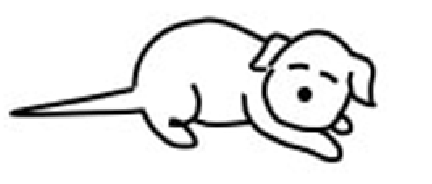
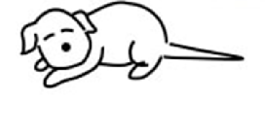

```{r setup, include=FALSE}
knitr::opts_chunk$set(warning = FALSE, message = FALSE, echo = FALSE,
                      fig.retina = 3, fig.align = "center",
                      dev = "ragg_png")  # ragg finds Fira Sans Condensed on Windows
```

```{r packages-data, include=FALSE}
library(tidyverse)
library(knitr)
source(here::here("R", "slide-things.R"))

# Colors from the slide theme, all readable on white ----
clr_bar <- "#538ba2"
clr_soft <- "#c5d9e2"
clr_mean <- "#a93e31"
clr_median <- "#244a70"
clr_mode <- "#8a6100"

theme_slides <- function(base_size = 20) {
  theme_minimal(base_size = base_size, base_family = "Fira Sans Condensed") +
    theme(panel.grid.minor = element_blank(),
          panel.grid.major.x = element_blank(),
          axis.title = element_text(face = "bold"),
          strip.text = element_text(face = "bold", size = rel(1)))
}

fmt <- function(x, d = 2) formatC(x, format = "f", digits = d)

# Baseline math scores, out of 35 ----
baseline <- read_csv(here::here("files", "data", "mindspark", "ms_blel_jpal_baseline.csv"),
                     show_col_types = FALSE)
math <- baseline$tot_math
n_all <- length(math)
score_mean <- mean(math)
score_median <- median(math)
score_mode <- as.numeric(names(which.max(table(math))))
score_q <- quantile(math, c(0.25, 0.75), names = FALSE)
ss_all <- sum((math - score_mean)^2)

score_pct <- tibble(score = math) %>%
  count(score) %>%
  mutate(pct = 100 * n / n_all) %>%
  complete(score = 0:26, fill = list(n = 0, pct = 0))

# Five real students for the prediction ----
five_a <- baseline$tot_math[1:5]
five_a_new <- replace(five_a, 3, 35)

# Five more for the calculations ----
five <- baseline$tot_math[4:8]
five_mean <- mean(five)
five_ss <- sum((five - five_mean)^2)

# Draw many samples of 5 from the 619 scores ----
set.seed(15)
true_var <- ss_all / n_all
samples <- map_dfr(1:5000, function(i) {
  x <- sample(math, 5, replace = TRUE)
  tibble(id = i, ss = sum((x - mean(x))^2))
}) %>%
  mutate(by_n = ss / 5, by_n1 = ss / 4, sd_hat = sqrt(by_n1))
share_over <- mean(samples$by_n > true_var)

# One sample of 5 for the spread picture ----
set.seed(10)
one_sample <- sample(math, 5)
```

```{r xaringanExtra, echo=FALSE}
xaringanExtra::use_xaringan_extra(c("tile_view"))
```

class: center middle main-title section-title-4

# Central tendency and variability

.class-info[

**Topic 3 · Tuesday, January 12**

.light[EDUC 15: Statistics for Education Research<br>
UCI School of Education
]

]

---

class: title title-8

# Where are we?

.pull-left-3[
.box-1.medium[Description]

.box-inv-1.small[Summarize data]

.box-inv-1.small[Visualize data]

.center[**We are here**]

.anteater[]
]

.pull-middle-3[
.box-6.medium[Prediction]
]

.pull-right-3[
.box-3.medium[Explanation]
]

.source[Peter the Anteater at a UC Irvine basketball game.]

???

Same map as last week. Today we summarize a whole distribution in two numbers: where it sits and how spread out it is.

---

name: outline
class: title title-8

# Plan for today

.box-1.medium.sp-after-half[What's typical?]

.box-6.medium.sp-after-half[Shape and spread]

.box-3.medium.sp-after-half[The standard deviation]

???

Three blocks of about 20 minutes. Each ends with students doing something: predict, try, predict.

---

layout: false
class: center middle section-title section-title-1 animated fadeIn

# What's typical?

---

layout: true
class: title title-1

---

# What value best describes this group?

```{r typical-plot, fig.width=10, fig.height=4.5, out.width="86%", fig.alt="Bar chart of baseline math scores for 619 Mindspark students. Scores run from 0 to 26 out of 35. The bars rise to a peak of about 12 percent of students at a score of 12, with most students between 7 and 16."}
ggplot(score_pct, aes(x = score, y = pct)) +
  geom_col(fill = clr_bar, width = 0.85) +
  scale_x_continuous(breaks = seq(0, 26, 2)) +
  labs(x = "Math score at baseline (out of 35)", y = "% of students") +
  theme_slides()
```

.source[Data: Muralidharan, Singh, and Ganimian (2019). `r n_all` students in Delhi.]

???

Ask: which single number would you report? 12, because it's the tallest bar? Why not 11? Or 11.5?

---

# Three ways to name a "typical" value

.pull-left-3[
.box-inv-1.medium[Mode]

The most frequent value

Find the value that occurs most often
]

.pull-middle-3[
.box-inv-1.medium[Median]

The midpoint of a distribution

Rank the scores and take the middle one. With an even number, average the middle two
]

.pull-right-3[
.box-inv-1.medium[Mean]

The average, or the balance point

Add up all the scores, then divide by how many there are
]

---

# The mean: one idea, two symbols

$$
\mu = \frac{\sum X}{N} \qquad\qquad M = \frac{\sum X}{n}
$$

.pull-left[
.box-inv-1.small[Population]

**μ** is the mean of everyone we care about. There are **N** of them
]

.pull-right[
.box-inv-1.small[Sample]

**M** is the mean of the **n** people we observed. It estimates μ
]

.box-1.small[Greek means population. A Latin letter or a hat means an estimate]

???

This rule comes back all quarter. Students should be able to label any symbol as a parameter or an estimate.

---

# Here, all three land close together

```{r three-values, fig.width=10, fig.height=4.5, out.width="86%", fig.alt="The same bar chart of baseline math scores, with three vertical lines close together near the middle: median at 11, mean at 11.12 and mode at 12."}
ggplot(score_pct, aes(x = score, y = pct)) +
  geom_col(fill = clr_soft, width = 0.85) +
  geom_vline(xintercept = score_median, color = clr_median, linewidth = 1.3, linetype = "dotted") +
  geom_vline(xintercept = score_mean, color = clr_mean, linewidth = 1.3) +
  geom_vline(xintercept = score_mode, color = clr_mode, linewidth = 1.3, linetype = "dashed") +
  annotate("text", x = score_median - 0.3, y = 14.2, label = paste("Median", score_median), hjust = 1,
           color = clr_median, size = 6.5, fontface = "bold", family = "Fira Sans Condensed") +
  annotate("text", x = score_mode + 0.3, y = 14.2, label = paste("Mode", score_mode), hjust = 0,
           color = clr_mode, size = 6.5, fontface = "bold", family = "Fira Sans Condensed") +
  annotate("text", x = score_mode + 0.3, y = 12.9, label = paste("Mean", fmt(score_mean)), hjust = 0,
           color = clr_mean, size = 6.5, fontface = "bold", family = "Fira Sans Condensed") +
  scale_x_continuous(breaks = seq(0, 26, 2)) +
  scale_y_continuous(limits = c(0, 15)) +
  labs(x = "Math score at baseline (out of 35)", y = "% of students") +
  theme_slides()
```

.source[Data: Muralidharan, Singh, and Ganimian (2019).]

---

layout: false
class: title title-8 poll-slide

# Predict it: One perfect score

.poll-respond[Respond at **PollEv.com/adb**]

.box-inv-8.small[
Five students scored `r paste(sort(five_a), collapse = ", ")`. Their mean is `r fmt(mean(five_a), 1)` and their median is `r median(five_a)`. Suppose one 13 becomes a perfect 35. What happens?
]

.options[
.option[
**A** Only the mean changes
]
.option[
**B** Only the median changes
]
.option[
**C** Both change
]
.option[
**D** Neither changes
]
]

???

About 6 minutes. Vote, turn to a neighbor, vote again, then show the answer.

Andy: create this poll in Poll Everywhere, then add the `.poll-bar` button from EDUC 265's 06-01 with its presenter id.

---

class: title title-8 poll-answer

# Predict it: Answer

.options[
.option.correct[
**A** Only the mean changes
]
.option.wrong[
**B** Only the median changes
]
.option.wrong[
**C** Both change
]
.option.wrong[
**D** Neither changes
]
]

.box-inv-8.small.sp-after-half[
The mean goes from `r fmt(mean(five_a), 1)` to `r fmt(mean(five_a_new), 1)`. The median stays at `r median(five_a_new)`
]

.box-8.small[
The mean uses every score's value. The median only uses their order
]

---

layout: false
class: center middle section-title section-title-6 animated fadeIn

# Shape and spread

---

layout: true
class: title title-6

---

# Skew is named after the tail

```{r skew-plot, fig.width=11, fig.height=2.9, out.width="84%", fig.alt="Three curves side by side. The left curve has its peak on the right and a long tail to the left, labeled skewed left. The middle curve is symmetric. The right curve has its peak on the left and a long tail to the right, labeled skewed right."}
shape_grid <- seq(0, 10, length.out = 300)
shapes <- bind_rows(
  tibble(x = shape_grid, y = dgamma(10 - shape_grid, 3, 1), shape = "Skewed left: long tail to the left"),
  tibble(x = shape_grid, y = dnorm(shape_grid, 5, 1.4), shape = "Symmetric"),
  tibble(x = shape_grid, y = dgamma(shape_grid, 3, 1), shape = "Skewed right: long tail to the right")
) %>%
  mutate(shape = fct_inorder(shape))

ggplot(shapes, aes(x = x, y = y)) +
  geom_area(fill = clr_soft, color = clr_bar, linewidth = 1.1) +
  facet_wrap(vars(shape), nrow = 1) +
  labs(x = NULL, y = NULL) +
  theme_slides(18) +
  theme(axis.text = element_blank(), panel.grid = element_blank())
```

.pull-left-3[
.dog[]
]

.pull-middle-3[
&nbsp;
]

.pull-right-3[
.dog[]
]

.box-inv-6.small[Our math scores are almost symmetric, so all three agreed]

.source[Dogs: Jawlik, *Statistics from A to Z: Confusing Concepts Clarified* (Wiley, 2016).]

---

# In a skewed distribution, they pull apart

```{r skew-order, fig.width=11, fig.height=4.2, out.width="92%", fig.alt="Two skewed curves. In the right-skewed curve, the mode is at the peak, the median is to its right, and the mean is farther right, toward the tail. In the left-skewed curve the order is reversed: the mean is farthest left, toward the tail, then the median, then the mode at the peak."}
right_marks <- c(Mode = 2, Median = qgamma(0.5, 3, 1), Mean = 3)
marks <- bind_rows(
  tibble(stat = names(right_marks), x = right_marks, panel = "Skewed right"),
  tibble(stat = names(right_marks), x = 10 - right_marks, panel = "Skewed left")
) %>%
  mutate(y = dgamma(if_else(panel == "Skewed right", x, 10 - x), 3, 1),
         panel = factor(panel, levels = c("Skewed right", "Skewed left")),
         top = case_when(stat == "Mode" ~ 0.30, stat == "Median" ~ 0.385, TRUE ~ 0.30),
         # Mode and mean sit on either side of the median, so their labels point away from it
         side = if_else((stat == "Mode") == (panel == "Skewed right"), 1, 0),
         side = if_else(stat == "Median", 0.5, side),
         clr = case_when(stat == "Mode" ~ clr_mode, stat == "Median" ~ clr_median, TRUE ~ clr_mean))
curves <- bind_rows(
  tibble(x = shape_grid, y = dgamma(shape_grid, 3, 1), panel = "Skewed right"),
  tibble(x = shape_grid, y = dgamma(10 - shape_grid, 3, 1), panel = "Skewed left")
) %>%
  mutate(panel = factor(panel, levels = c("Skewed right", "Skewed left")))

ggplot(curves, aes(x = x, y = y)) +
  geom_area(fill = clr_soft, color = clr_bar, linewidth = 1.1) +
  geom_segment(data = marks, aes(x = x, xend = x, y = 0, yend = top, color = I(clr)), linewidth = 1.1) +
  geom_text(data = marks, aes(x = x + (0.5 - side) * 0.25, y = top + 0.022, label = stat, hjust = side, color = I(clr)),
            size = 6, fontface = "bold", family = "Fira Sans Condensed") +
  facet_wrap(vars(panel), nrow = 1) +
  coord_cartesian(ylim = c(0, 0.47)) +
  labs(x = NULL, y = NULL) +
  theme_slides(18) +
  theme(axis.text = element_blank(), panel.grid = element_blank())
```

.box-inv-6.small[The mean gets pulled toward the tail. That's the perfect score you just saw]

---

class: title title-6 long-title

# So which one should you report?

```{r choose-table, results="asis"}
tribble(
  ~Measure, ~`Works well for`, ~`Can mislead with`,
  "Mean", "Interval or ratio scales, when you know every score", "Extreme scores, skewed distributions, open-ended categories",
  "Median", "Extreme scores, skewed distributions, open-ended categories, ordinal scales", "Nominal scales",
  "Mode", "Nominal scales, discrete variables, describing shape", "Interval or ratio data, unless it comes with the mean or median"
) %>%
  kable(format = "html", table.attr = 'class="deck-table"')
```

---

# The range: how far the scores stretch

.box-6.medium.sp-after-half[Range = highest score − lowest score]

.box-inv-6.small.sp-after-half[
In our data: `r max(math)` − `r min(math)` = `r max(math) - min(math)` points
]

.box-inv-6.small[
It's easy to find, but only two scores set it
]

???

The book also defines the range with real limits for continuous variables. That detail isn't worth class time.

---

# The interquartile range: the middle 50%

```{r iqr-plot, fig.width=10, fig.height=4.3, out.width="86%", fig.alt="Bar chart of baseline math scores. Bars from 9 to 14, the middle of the scores, are dark, and the rest are pale. Vertical lines mark the first quartile at 9 and the third quartile at 14."}
score_pct %>%
  mutate(middle = score >= score_q[1] & score <= score_q[2]) %>%
  ggplot(aes(x = score, y = pct, fill = middle)) +
  geom_col(width = 0.85) +
  geom_vline(xintercept = score_q, color = clr_median, linewidth = 1.1, linetype = "dashed") +
  annotate("text", x = score_q[1] - 0.3, y = 13.6, label = paste("Q1 =", score_q[1]), hjust = 1,
           color = clr_median, size = 6.5, fontface = "bold", family = "Fira Sans Condensed") +
  annotate("text", x = score_q[2] + 0.3, y = 13.6, label = paste("Q3 =", score_q[2]), hjust = 0,
           color = clr_median, size = 6.5, fontface = "bold", family = "Fira Sans Condensed") +
  scale_fill_manual(values = c(`FALSE` = clr_soft, `TRUE` = clr_bar), guide = "none") +
  scale_x_continuous(breaks = seq(0, 26, 2)) +
  scale_y_continuous(limits = c(0, 14.5)) +
  labs(x = "Math score at baseline (out of 35)", y = "% of students") +
  theme_slides()
```

.box-inv-6.small[IQR = `r score_q[2]` − `r score_q[1]` = `r diff(score_q)` points. One extreme student can't move it]

.source[Data: Muralidharan, Singh, and Ganimian (2019).]

---

layout: false
class: title title-8

# Try it: Five real students

.box-inv-8.medium.sp-after-half[Scores: `r paste(five, collapse = ", ")`]

.box-8.small.sp-after-half[Find the mean, the median and the range]

.box-inv-8.small[Work alone for two minutes. Compare with a neighbor. Then we vote]

???

About 6 minutes, with calculators. Students who finish early can write down why the mean and median differ.

---

class: title title-8

# Try it: Answer

.pull-left-3[
.box-inv-8.medium[Mean]

.center[(`r paste(five, collapse = " + ")`) / 5 = **`r fmt(five_mean, 1)`**]
]

.pull-middle-3[
.box-inv-8.medium[Median]

.center[In order: `r paste(sort(five), collapse = ", ")`. The middle one is **`r median(five)`**]
]

.pull-right-3[
.box-inv-8.medium[Range]

.center[`r max(five)` − `r min(five)` = **`r max(five) - min(five)`**]
]

---

layout: false
class: center middle section-title section-title-3 animated fadeIn

# The standard deviation

---

layout: true
class: title title-3

---

# How far is a typical score from μ?

.box-inv-3.small[Say these five students are everyone we care about, so μ = `r fmt(five_mean, 1)`]

```{r deviations-table, results="asis"}
tibble(X = five) %>%
  mutate(dev = X - five_mean, sq = dev^2) %>%
  mutate(across(c(dev, sq), ~ str_replace(fmt(.x, if_else(cur_column() == "dev", 1, 2)), "-", "−"))) %>%
  rename(`Score X` = X, `Deviation X − μ` = dev, `Squared deviation` = sq) %>%
  kable(format = "html", align = "c", table.attr = 'class="deck-table tight"')
```

.box-3.small[Add up the last column to get the sum of squares: SS = `r fmt(five_ss, 1)`]

???

Why square? Deviations from the mean always add up to zero, so their plain average tells us nothing.

---

# Four steps to the standard deviation

```{r four-steps, results="asis"}
tribble(
  ~Step, ~`In symbols`, ~`Our five students`,
  "1. Find each deviation", "\\(X - \\mu\\)", "The table we just built",
  "2. Square them and add them up", "\\(SS = \\sum (X - \\mu)^2\\)", paste("SS =", fmt(five_ss, 1)),
  "3. Average them: the variance", "\\(\\sigma^2 = SS / N\\)", paste0(fmt(five_ss, 1), " / 5 = ", fmt(five_ss / 5)),
  "4. Take the root: the SD", "\\(\\sigma = \\sqrt{\\sigma^2}\\)", paste0("√", fmt(five_ss / 5), " = ", fmt(sqrt(five_ss / 5)))
) %>%
  kable(format = "html", escape = FALSE, table.attr = 'class="deck-table"')
```

.box-3.small[Variance is the average squared distance. The SD puts it back in points]

---

# We rarely see the whole population

```{r spread-plot, fig.width=10, fig.height=3.5, out.width="86%", fig.alt="Bar chart of all 619 baseline math scores, spanning 0 to 26, with five dark diamonds below it showing one random sample of five students. The five diamonds cover a narrower span than the full set of scores."}
ggplot(score_pct, aes(x = score, y = pct)) +
  geom_col(fill = clr_soft, width = 0.85) +
  geom_point(data = tibble(score = one_sample, pct = -1.6), shape = 18, size = 8, color = clr_median) +
  annotate("text", x = 26, y = -1.6, label = "One sample of 5", hjust = 1, color = clr_median,
           size = 6.5, fontface = "bold", family = "Fira Sans Condensed") +
  scale_x_continuous(breaks = seq(0, 26, 2)) +
  labs(x = "Math score at baseline (out of 35)", y = "% of students") +
  theme_slides()
```

.box-inv-3.small[A small sample rarely catches the extreme scores, so it tends to look less spread out than its population]

.source[Data: Muralidharan, Singh, and Ganimian (2019).]

---

layout: false
class: title title-8 long-title

# Predict it: Treat the 619 students as a population

.box-inv-8.small.sp-after-half[Their variance is σ² = `r fmt(true_var)`. Draw 5,000 samples of 5. In each one, compute SS / n]

.box-8.small.sp-after-half[Across all 5,000 samples, what does SS / n average out to?]

.options[
.option[
**A** Less than `r fmt(true_var)`
]
.option[
**B** About `r fmt(true_var)`
]
.option[
**C** More than `r fmt(true_var)`
]
]

???

About 6 minutes. Hands are fine here. Ask students to say why before showing the next slide.

---

class: title title-8

# Predict it: SS / n falls short on average

```{r bias-plot, fig.width=11, fig.height=3.9, out.width="92%", fig.alt="Two histograms of an estimate of the variance across 5,000 samples of 5 students, with a vertical line at the true value of 15.22. Dividing by n has an average of about 12, well below the true value. Dividing by n minus 1 has an average of about 15, close to the true value."}
est <- samples %>%
  select(by_n, by_n1) %>%
  pivot_longer(everything(), names_to = "how", values_to = "value") %>%
  mutate(how = recode(how, by_n = "Dividing by n", by_n1 = "Dividing by n − 1"))
avg <- est %>% group_by(how) %>% summarize(m = mean(value))

ggplot(est, aes(x = value)) +
  geom_histogram(binwidth = 2, boundary = 0, fill = clr_soft, color = "white") +
  geom_vline(xintercept = true_var, color = clr_median, linewidth = 1.2, linetype = "dashed") +
  geom_vline(data = avg, aes(xintercept = m), color = clr_mean, linewidth = 1.2) +
  geom_text(data = avg, aes(x = 30, y = 800, label = paste0("Average: ", fmt(m))),
            hjust = 0, color = clr_mean, size = 6.5, fontface = "bold", family = "Fira Sans Condensed") +
  geom_text(data = avg, aes(x = 30, y = 640, label = paste0("True σ²: ", fmt(true_var))),
            hjust = 0, color = clr_median, size = 6.5, fontface = "bold", family = "Fira Sans Condensed") +
  facet_wrap(vars(how), nrow = 1) +
  coord_cartesian(xlim = c(0, 60)) +
  labs(x = "Estimate of the variance", y = "Samples") +
  theme_slides(18)
```

.box-inv-8.small[SS / n tends to be too small, though `r round(100 * share_over)`% of samples still overshoot. Dividing by n − 1 lands on target on average]

.source[Data: Muralidharan, Singh, and Ganimian (2019). Samples drawn from those scores.]

---

layout: true
class: title title-3

---

# Our estimate of the population variance

$$
\hat{\sigma}^2 = \frac{SS}{n - 1} \qquad\qquad \hat{\sigma} = \sqrt{\hat{\sigma}^2}
$$

.pull-left[
.box-inv-3.small[
The hat says this is an estimate. n − 1 is called the *degrees of freedom*
]
]

.pull-right[
.box-inv-3.small[
SS / n is still the sample's own variance. It just isn't our best guess about the population
]
]

.book-tag[In the book: σ̂² is written s², and σ̂ is written s]

???

The variance estimate is unbiased. Its square root runs a little low: here it averages `r fmt(mean(samples$sd_hat))` against a true SD of `r fmt(sqrt(true_var))`. That's worth saying only if someone asks.

---

# Our five students, now as a sample

```{r notation-table, results="asis"}
tribble(
  ~` `, ~Population, ~`Sample`,
  "How many", "N", "n = 5",
  "Mean", "μ", paste0("M = ", fmt(five_mean, 1)),
  "Variance", "σ² = SS / N", paste0("σ̂² = ", fmt(five_ss, 1), " / 4 = ", fmt(five_ss / 4)),
  "Standard deviation", "σ", paste0("σ̂ = ", fmt(sqrt(five_ss / 4)))
) %>%
  kable(format = "html", align = "lcc", table.attr = 'class="deck-table"')
```

.box-3.small[With all `r n_all` students, n − 1 hardly matters: σ̂ = `r fmt(sd(math))`, against `r fmt(sqrt(true_var))` when dividing by n]

---

layout: false
class: title title-8

# What you can do now

.box-inv-8.small[Find and choose among the mean, median and mode]

.box-inv-8.small[Say how skew pulls the mean toward the tail]

.box-inv-8.small[Compute SS, the variance and the SD by hand]

.box-inv-8.small[Label a symbol as a parameter or an estimate, and say why we divide by n − 1]

---

class: title title-8

# Next steps

.pull-left[
.box-1.small[Before Thursday]

Read Chapter 5
]

.pull-right[
.box-6.small[This Friday: Lab 2]

Bring a calculator and a laptop. It includes a 15-minute individual check
]

.box-3.small[Mastery and Problem Set for Chapter 5 are due Sunday at 6 PM]

---

class: title title-3

# Bonus: A faster way to compute SS

.small[Start from the definition, multiply out the square, and use μ = ΣX / N:]

$$
SS = \sum (X - \mu)^2 = \sum X^2 - 2\mu \sum X + N\mu^2
$$

$$
SS = \sum X^2 - \frac{(\sum X)^2}{N}
$$

.box-inv-3.small[This needs no deviations, so it's quicker with a calculator]

```{css, echo=FALSE}
/* Images sit under the title. These heights leave room for a source line */
.picture img {
  display: block;
  margin: 0 auto;
  max-width: 100%;
  max-height: 440px;
}

.picture-small img {
  display: block;
  margin: 0 auto;
  max-width: 100%;
  max-height: 230px;
}

.anteater img {
  display: block;
  margin: 0.15em auto 0;
  max-height: 105px;
}

.dog img {
  display: block;
  margin: -0.2em auto 0;
  max-height: 72px;
}

/* This chunk sits at the end because any output before the first slide's
   "class:" line stops remark from reading that slide's properties */

/* Long titles get two smaller lines inside the 110 px title bar */
.remark-slide-content.long-title h1 {
  font-size: 1.05em;
  line-height: 1.05;
  margin-top: -100px;
  margin-bottom: 55px;
}

.source {
  position: absolute;
  bottom: 18px;
  left: 60px;
  font-size: 0.55em;
  color: #47505a;
}

.book-tag {
  margin-top: 0.7em;
  font-size: 0.65em;
  color: #47505a;
  text-align: right;
}

table.deck-table {
  width: 92%;
  margin: 0.4em auto;
  border-collapse: collapse;
  font-size: 0.72em;
}

table.deck-table.tight td,
table.deck-table.tight th {
  padding: 0.12em 0.6em;
}

table.deck-table th {
  border-bottom: 2px solid #244a70;
  padding: 0.3em 0.6em;
}

table.deck-table td {
  border-bottom: 1px solid #c9d1d9;
  padding: 0.3em 0.6em;
}

.options {
  display: grid;
  grid-template-columns: 1fr 1fr;
  gap: 0.35em 1em;
  margin-top: 0.6em;
  font-size: 0.65em;
}

.option {
  background-color: #f3f3f3;
  border: 2px solid #cccccc;
  padding: 0.35em 0.6em;
}

.option.correct {
  background-color: #b18323;
  border-color: #b18323;
  color: white;
}

.option.wrong {
  opacity: 0.6;
}

.poll-respond {
  display: block;
  font-size: 0.5em;
  text-align: center;
  margin-top: 0.1em;
}

/* The printed PDF keeps the question and drops the answer slide */
@media print {
  .remark-slide-container:has(.poll-answer) {
    display: none !important;
  }
}
```
