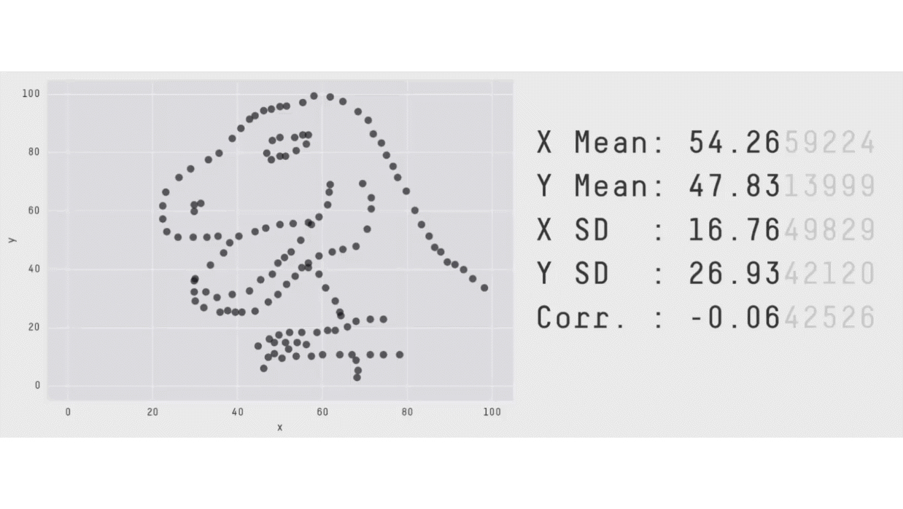

```{r setup, include=FALSE}
knitr::opts_chunk$set(warning = FALSE, message = FALSE, echo = FALSE,
                      fig.retina = 3, fig.align = "center",
                      dev = "ragg_png")  # ragg finds Fira Sans Condensed on Windows
```

```{r packages-data, include=FALSE}
library(tidyverse)
library(knitr)
source(here::here("R", "slide-things.R"))

# Colors from the slide theme, all readable on white ----
clr_bar <- "#538ba2"
clr_soft <- "#c5d9e2"
clr_mean <- "#a93e31"
clr_median <- "#244a70"
clr_mode <- "#8a6100"

theme_slides <- function(base_size = 20) {
  theme_minimal(base_size = base_size, base_family = "Fira Sans Condensed") +
    theme(panel.grid.minor = element_blank(),
          panel.grid.major.x = element_blank(),
          axis.title = element_text(face = "bold"),
          strip.text = element_text(face = "bold", size = rel(1)))
}

fmt <- function(x, d = 2) str_replace(formatC(if_else(round(x, d) == 0, 0, x), format = "f", digits = d), "-", "−")
pct <- function(x, d = 0) paste0(fmt(100 * x, d), "%")
p_text <- function(p) if (p < 0.001) "p < 0.001" else paste("p =", fmt(p, 3))

label_text <- function(x, y, label, color = clr_median, hjust = 0.5, size = 6.5) {
  annotate("text", x = x, y = y, label = label, color = color, hjust = hjust, size = size,
           fontface = "bold", family = "Fira Sans Condensed")
}

# Everything a test of r needs, from r and n ----
test_r <- function(r, n) {
  df <- n - 2
  se <- sqrt((1 - r^2) / df)
  t_stat <- r / se
  list(r = r, n = n, df = df, r2 = r^2, se = se, t = t_stat, crit = qt(0.975, df),
       p = 2 * pt(-abs(t_stat), df))
}

# Mindspark math scores. Everyone at endline also has a baseline score ----
baseline <- read_csv(here::here("files", "data", "mindspark", "ms_blel_jpal_baseline.csv"),
                     show_col_types = FALSE)
endline <- read_csv(here::here("files", "data", "mindspark", "ms_blel_jpal_endline.csv"),
                    show_col_types = FALSE)
both <- inner_join(select(baseline, st_id, X = tot_math, grade = st_grade1),
                   select(endline, st_id, Y = tot_math, treat),
                   by = "st_id")
all_r <- cor(both$X, both$Y)
all <- test_r(all_r, nrow(both))
all_ci <- cor.test(both$X, both$Y)$conf.int

# Students 25 to 32, the 2024 hand example ----
hand <- function(d) {
  d <- mutate(d, dx = X - mean(X), dy = Y - mean(Y), prod = dx * dy)
  ss_x <- sum(d$dx^2)
  ss_y <- sum(d$dy^2)
  sp <- sum(d$prod)
  list(d = d, n = nrow(d), mx = mean(d$X), my = mean(d$Y), ss_x = ss_x, ss_y = ss_y, sp = sp,
       bottom = sqrt(ss_x * ss_y), r = sp / sqrt(ss_x * ss_y))
}
eight <- hand(slice(both, 25:32))
eight_t <- test_r(eight$r, eight$n)

# Five students for the try-it. Their arithmetic is easy, and their r has the wrong sign ----
five <- hand(slice(both, 289:293))

# Nine fifth graders for the last try-it ----
fifth <- filter(both, grade == 5)
fifth_t <- test_r(cor(fifth$X, fifth$Y), nrow(fifth))

# Only a narrow range of baseline scores ----
narrow_lo <- 10
narrow_hi <- 12
narrow <- filter(both, between(X, narrow_lo, narrow_hi))
narrow_r <- cor(narrow$X, narrow$Y)

# One made-up student added to 8 students, then to all of them ----
ghost <- tibble(X = max(both$X), Y = 5)
ghost_8 <- cor(c(eight$d$X, ghost$X), c(eight$d$Y, ghost$Y))
ghost_all <- cor(c(both$X, ghost$X), c(both$Y, ghost$Y))

# Treat the students as a population, and draw many samples of 8 ----
set.seed(15)
draws_8 <- replicate(20000, {
  i <- sample(nrow(both), 8, replace = TRUE)
  suppressWarnings(cor(both$X[i], both$Y[i]))
})
draws_range <- quantile(draws_8, c(0.025, 0.975), na.rm = TRUE, names = FALSE)
draws_high <- mean(draws_8 >= eight$r, na.rm = TRUE)

# Two correlations, and who set X ----
tui <- test_r(cor(baseline$any_tuition, baseline$tot_math), nrow(baseline))
win <- test_r(cor(both$treat, both$Y), nrow(both))
win_before <- test_r(cor(both$treat, both$X), nrow(both))

# Other correlations, on the same students ----
r_spearman <- cor(both$X, both$Y, method = "spearman")
r_phi <- cor(both$treat, both$Y > median(both$Y))

# The simulator's Add outlier button with these presets, read from the tool ----
sim_r <- 0.6
sim_seed <- 2027
sim_small <- 12
sim_big <- 200
sim_small_after <- 0.33
sim_big_after <- 0.54

# Made-up data for the pictures of r: X and Y have exactly this correlation ----
exact_r <- function(r, n = 60) {
  x <- as.numeric(scale(rnorm(n)))
  e <- as.numeric(scale(resid(lm(rnorm(n) ~ x))))
  tibble(x = x, y = r * x + sqrt(1 - r^2) * e)
}
```

```{r xaringanExtra, echo=FALSE}
xaringanExtra::use_xaringan_extra(c("tile_view"))
```

class: center middle main-title section-title-4

# Correlation

.class-info[

**Topic 11 · Tuesday, March 2**

.light[EDUC 15: Statistics for Education Research<br>
UCI School of Education
]

]

---

class: title title-8

# Where are we?

.pull-left-3[
.box-1.medium[Description]

.box-inv-1.small[Summarize data]

.box-inv-1.small[Visualize data]
]

.pull-middle-3[
.box-6.medium[Prediction]

.box-inv-6.small[Does one score go with another?]

.center[**We are here**]

.anteater[]
]

.pull-right-3[
.box-3.medium[Explanation]
]

.source[Peter the Anteater at a UC Irvine basketball game.]

???

Same map. Until now we've compared groups. Today each person has two scores, and we ask how the scores go together. It's the first step toward regression, which takes three sessions after this one.

---

name: outline
class: title title-8

# Plan for today

.box-1.medium.sp-after-half[What r shows]

.box-6.medium.sp-after-half[Computing r]

.box-3.medium.sp-after-half[Testing r]

???

Three blocks of about 20 minutes. Each ends with students doing something: predict, try, try. The running question: does a student's baseline math score predict their endline score?

---

layout: false
class: center middle section-title section-title-1 animated fadeIn

# What r shows

---

layout: true
class: title title-1

---

# Each dot is one student

```{r scatter-plot, fig.width=10, fig.height=4.5, out.width="86%", fig.alt=paste0("Scatter plot of ", all$n, " Mindspark students, with baseline math score on the horizontal axis and endline math score on the vertical axis. The dots form a wide cloud that rises from lower left to upper right.")}
ggplot(both, aes(x = X, y = Y)) +
  geom_point(position = position_jitter(width = 0.25, height = 0.25, seed = 15),
             color = clr_bar, alpha = 0.6, size = 2.4) +
  scale_x_continuous(breaks = seq(0, 26, 4)) +
  scale_y_continuous(breaks = seq(0, 32, 8)) +
  labs(x = "Math score at baseline", y = "Math score at endline") +
  theme_slides()
```

.source[Data: Muralidharan, Singh, and Ganimian (2019). `r all$n` students. Dots are nudged so equal scores don't hide each other.]

???

Our question from 2024: does a student's baseline score predict their endline score? Every student has two scores, so every student is one dot.

Ask: what do you see? Students who start higher tend to end higher, but there's a lot of scatter. We aren't saying anything about what causes what yet.

---

# A correlation describes three things

```{r features-plot, fig.width=11, fig.height=4.1, out.width="88%", fig.alt="Six small scatter plots of made-up data in three columns. Direction: one cloud rises and one falls. Form: one cloud follows a straight line and one follows an arch. Consistency: one cloud hugs a line tightly and one is loose."}
set.seed(11)
curve_x <- runif(60, -2, 2)
features <- bind_rows(
  mutate(exact_r(0.8), panel = "Direction: up"),
  mutate(exact_r(-0.8), panel = "Direction: down"),
  mutate(exact_r(0.85), panel = "Form: straight"),
  tibble(x = curve_x, y = -curve_x^2 + rnorm(60, 0, 0.3), panel = "Form: curved"),
  mutate(exact_r(0.97), panel = "Consistency: tight"),
  mutate(exact_r(0.45), panel = "Consistency: loose")
) %>%
  mutate(panel = fct_inorder(panel))

ggplot(features, aes(x = x, y = y)) +
  geom_point(color = clr_bar, size = 2) +
  facet_wrap(vars(panel), ncol = 3, dir = "v", scales = "free_y") +
  labs(x = NULL, y = NULL) +
  theme_slides(16) +
  theme(axis.text = element_blank(), panel.grid = element_blank(),
        panel.border = element_rect(fill = NA, color = "#c9d1d9"))
```

.box-inv-1.small[Which way does it go? Is it straight? How closely do the dots follow it?]

.source[Made-up data.]

???

Direction: when X goes up, does Y go up or down? Form: a straight line, or a curve? Consistency: how well does X tell you Y?

Everyday pairs: years of education and income, or hours of cat videos and happiness. A correlation says nothing about what causes what.

---

# r runs from −1 to 1

```{r gallery-plot, fig.width=11, fig.height=3.3, out.width="92%", fig.alt="Four scatter plots of made-up data. With r of minus 1, the dots lie on a falling line. With r of minus 0.4, a loose falling cloud. With r of 0, a round cloud with no direction. With r of 0.9, a tight rising cloud."}
set.seed(4)
gallery <- map_dfr(c(-1, -0.4, 0, 0.9), function(r) {
  mutate(exact_r(r), panel = paste("r =", fmt(r, 1)))
}) %>%
  mutate(panel = fct_inorder(panel))

ggplot(gallery, aes(x = x, y = y)) +
  geom_point(color = clr_bar, size = 2) +
  facet_wrap(vars(panel), nrow = 1) +
  labs(x = NULL, y = NULL) +
  theme_slides(18) +
  theme(axis.text = element_blank(), panel.grid = element_blank(),
        panel.border = element_rect(fill = NA, color = "#c9d1d9"))
```

.box-inv-1.small.sp-after-half[The sign gives the direction. The distance from 0 gives the consistency]

.box-1.small[Our `r all$n` students: r = `r fmt(all$r)`. Upward, roughly straight, and loose]

.source[Top: made-up data. Bottom: Muralidharan, Singh, and Ganimian (2019).]

???

This is Pearson's correlation. Pearson's r needs a straight-line form, which is the next slide. r has no units: it doesn't matter whether we use points, percent or z-scores.

In the book, the sample value is also r. Greek ρ is the population value, and it comes in the third block.

---

# Same r, four different stories

```{r anscombe-plot, fig.width=11, fig.height=3.5, out.width="92%", fig.alt="Four scatter plots from Anscombe's quartet. All have a correlation of 0.82. The first is a loose straight cloud. The second is a smooth curve. The third is a tight line with one point far above it. The fourth is a stack of points at one X value, with one distant point that creates the correlation."}
ans_names <- c("A loose line", "A curve", "A line and one outlier", "No line, one outlier")
ans <- map_dfr(1:4, function(i) {
  tibble(x = anscombe[[paste0("x", i)]], y = anscombe[[paste0("y", i)]], set = ans_names[i])
}) %>%
  mutate(set = factor(set, levels = ans_names))
ans_r <- ans %>% group_by(set) %>% summarize(r = cor(x, y))

ggplot(ans, aes(x = x, y = y)) +
  geom_point(color = clr_bar, size = 3) +
  geom_text(data = ans_r, aes(x = 4, y = 12.6, label = paste("r =", fmt(r))), hjust = 0, color = clr_median,
            size = 5.5, fontface = "bold", family = "Fira Sans Condensed") +
  facet_wrap(vars(set), nrow = 1) +
  scale_x_continuous(limits = c(3.5, 19.5)) +
  scale_y_continuous(limits = c(2.5, 13.5)) +
  labs(x = NULL, y = NULL) +
  theme_slides(16) +
  theme(axis.text = element_blank(), panel.grid = element_blank(),
        panel.border = element_rect(fill = NA, color = "#c9d1d9"))
```

.box-inv-1.small.sp-after-half[r measures straight lines only. The second panel is a perfect curve, and r can't tell]

.box-1.small[Plot your data before you trust the number]

.source[Data: Anscombe (1973), four made-up data sets.]

???

Each panel has 11 points, and all four have r = `r fmt(ans_r$r[1])`. Only the first one is what r = `r fmt(ans_r$r[1])` makes you picture. Our 8 students later today happen to have the same r. Any r can hide any of these.

---

# Don't forget to plot your data

.box-1.small.sp-after-half[All of these data sets have the same means, SDs and correlation]

<div class="datasaurus">


<button type="button" class="play-button" onclick="var d=this.parentNode,s=d.querySelector('.ds-still'),m=d.querySelector('.ds-moving'),p=m.hidden;m.hidden=!p;s.hidden=p;this.textContent=p?'Pause':'Play';" onkeydown="event.stopPropagation()" onkeypress="event.stopPropagation()">Play</button>
</div>

.source[Matejka and Fitzmaurice (2017), ["Same Stats, Different Graphs,"](https://www.research.autodesk.com/publications/same-stats-different-graphs/) CHI 2017. Datasaurus: Alberto Cairo.]

???

Press Play. It starts paused, so the printed PDF shows the dinosaur.

---

# A narrow range hides a correlation

```{r range-plot, fig.width=10, fig.height=4.1, out.width="84%", fig.alt=paste0("The scatter plot of all ", all$n, " students. A band marks baseline scores from ", narrow_lo, " to ", narrow_hi, ", and its dots are dark, while the rest are pale. Across all students r is ", fmt(all$r), ". Inside the band the dots show no direction, and r is ", fmt(narrow_r), ".")}
both %>%
  mutate(inside = between(X, narrow_lo, narrow_hi)) %>%
  ggplot(aes(x = X, y = Y)) +
  annotate("rect", xmin = narrow_lo - 0.5, xmax = narrow_hi + 0.5, ymin = -Inf, ymax = Inf,
           fill = clr_soft, alpha = 0.45) +
  geom_point(aes(color = inside), position = position_jitter(width = 0.25, height = 0.25, seed = 15),
             size = 2.2) +
  scale_color_manual(values = c(`FALSE` = "#b4bcc4", `TRUE` = clr_median), guide = "none") +
  label_text(0, 30.5, paste("All students: r =", fmt(all$r)), "#47505a", hjust = 0) +
  label_text(narrow_hi + 1, 3, paste0("Baseline ", narrow_lo, " to ", narrow_hi, ": r = ", fmt(narrow_r)), clr_median, hjust = 0) +
  scale_x_continuous(breaks = seq(0, 26, 4)) +
  scale_y_continuous(breaks = seq(0, 32, 8)) +
  labs(x = "Math score at baseline", y = "Math score at endline") +
  theme_slides()
```

.box-inv-1.small[Same tests, `r nrow(narrow)` students. We can only speak for the range we observed]

.source[Data: Muralidharan, Singh, and Ganimian (2019).]

???

This replaces the book's figure from 2024, using our own data. The relationship didn't go away. We just looked where X barely varies.

It happens whenever a study selects people on X. Among students admitted to a selective school, entrance scores predict grades less well than they do across all applicants.

---

layout: false
class: title title-8 poll-slide

# Predict it: One point, far from the rest

.poll-respond[Respond at **PollEv.com/adb**]

.box-inv-8.small[
A scatter plot has `r sim_small` points and r = `r fmt(sim_r)`. We add one new point: far to the right, and near the bottom. What happens to r?
]

.options[
.option[
**A** It goes up
]
.option[
**B** It barely moves
]
.option[
**C** It drops a lot
]
.option[
**D** It becomes exactly 0
]
]

???

About 6 minutes for this slide and the next four. Vote, turn to a neighbor, vote again, then watch it live.

Andy: create this poll in Poll Everywhere, then add the `.poll-bar` button from EDUC 265's 06-01 with its presenter id.

---

class: title title-8

# Predict it: Add the outlier

```{r sim-outlier, results="asis"}
sim_frame(
  alt = paste0("Simulator's correlation view with ", sim_small, " draggable points that rise from lower left to upper right, a regression line, and a readout showing r of ", fmt(sim_r), "."),
  tab = "correlation", n = sim_small, r = sim_r, seed = sim_seed, height = 495
)
```

.source[Simulator after Kristoffer Magnusson, rpsychologist.com. On your phone: [the simulator page](https://educ15.de-barros.com/resource/simulator-correlation.html).]

???

**Press Add outlier.** r falls from `r fmt(sim_r)` to `r fmt(sim_small_after)`. **Now drag that point** around while students call out what r will do. Drag it toward the corner, then back into the cloud.

Students can't drag on this screen. Those with a phone or laptop can open the simulator's Correlation and regression page on the course site, where every point can be dragged.

Leave Residuals and Squared residuals off. They belong to Topic 12. The line is there to show the direction.

---

class: title title-8 poll-answer

# Predict it: Answer

.options[
.option.wrong[
**A** It goes up
]
.option.wrong[
**B** It barely moves
]
.option.correct[
**C** It drops a lot
]
.option.wrong[
**D** It becomes exactly 0
]
]

.box-inv-8.small.sp-after-half[
One new point took r from `r fmt(sim_r)` to `r fmt(sim_small_after)`, nearly half
]

.box-8.small[
Now, the same move with `r sim_big` points. Hands: does r fall by more, by less, or by the same?
]

---

class: title title-8

# Predict it: Same move, `r sim_big` points

```{r sim-outlier-big, results="asis"}
sim_frame(
  alt = paste0("Simulator's correlation view with ", sim_big, " draggable points in a rising cloud, a regression line, and a readout showing r of ", fmt(sim_r), "."),
  tab = "correlation", n = sim_big, r = sim_r, seed = sim_seed, height = 495
)
```

.source[Simulator after Kristoffer Magnusson, rpsychologist.com.]

???

**Press Add outlier.** r only falls from `r fmt(sim_r)` to `r fmt(sim_big_after)`. Drag it around. One point now has much less pull, because it's one of `r sim_big + 1`.

---

layout: true
class: title title-1

---

# One outlier swings 8 students, not `r all$n`

```{r ghost-plot, fig.width=11, fig.height=3.9, out.width="92%", fig.alt=paste0("Two scatter plots of baseline against endline math scores, each with one made-up student added at a baseline of ", ghost$X, " and an endline of ", ghost$Y, ". With 8 real students, r falls from ", fmt(eight$r), " to ", fmt(ghost_8), ". With all ", all$n, " students, r falls only from ", fmt(all$r), " to ", fmt(ghost_all), ".")}
ghost_panels <- c(paste0("8 students: ", fmt(eight$r), " becomes ", fmt(ghost_8)),
                  paste0(all$n, " students: ", fmt(all$r), " becomes ", fmt(ghost_all)))
ghost_dots <- bind_rows(
  transmute(eight$d, X, Y, panel = ghost_panels[1]),
  transmute(both, X, Y, panel = ghost_panels[2])
) %>%
  mutate(panel = factor(panel, levels = ghost_panels))
ghost_mark <- crossing(ghost, panel = factor(ghost_panels, levels = ghost_panels))

ggplot(ghost_dots, aes(x = X, y = Y)) +
  geom_point(position = position_jitter(width = 0.2, height = 0.2, seed = 15), color = clr_bar, alpha = 0.7, size = 2.4) +
  geom_point(data = ghost_mark, shape = 18, size = 7, color = clr_mean) +
  geom_text(data = ghost_mark, label = "Made-up student", hjust = 1, nudge_x = 0.6, nudge_y = -3.6, color = clr_mean,
            size = 6, fontface = "bold", family = "Fira Sans Condensed") +
  facet_wrap(vars(panel), nrow = 1) +
  labs(x = "Math score at baseline", y = "Math score at endline") +
  theme_slides(18)
```

.box-inv-1.small[The same made-up student flips the sign for 8 students, and barely touches the `r all$n`. Outliers matter less as n grows]

.source[One made-up student added. Other data: Muralidharan, Singh, and Ganimian (2019).]

???

The same lesson as the simulator, on our own students. Only the diamond is invented. An outlier isn't a reason to delete a student. It's a reason to look, and to report what happens with and without them.

---

# So what is a correlation good for?

.pull-left[
.box-inv-1.small[Prediction]

Baseline scores can flag who may need help, whatever the reason

.box-inv-1.small[Reliability]

The same test, given twice, should give similar scores
]

.pull-right[
.box-inv-1.small[Validity]

A new math test should correlate with an established one

.box-inv-1.small[Testing theories]

A theory says two things go together. Do they?
]

???

The first three are everyday uses in education research, and none of them needs a causal story. The fourth is where people get into trouble, which we come back to later today.

---

layout: false
class: center middle section-title section-title-6 animated fadeIn

# Computing r

---

layout: true
class: title title-6

---

# Eight students, by hand

.pull-left[
```{r eight-table, results="asis"}
eight$d %>%
  transmute(`Baseline X` = X, `Endline Y` = Y) %>%
  kable(format = "html", align = "c", table.attr = 'class="deck-table tight"')
```
]

.pull-right[
```{r eight-plot, fig.width=6, fig.height=4.6, out.width="100%", fig.alt="Scatter plot of the eight students, with baseline scores from 8 to 13 and endline scores from 16 to 30. The dots rise from lower left to upper right. Two students share the point at 8 and 16."}
ggplot(eight$d, aes(x = X, y = Y)) +
  geom_point(color = clr_bar, size = 4.5) +
  label_text(8.3, 15.4, "Two students", hjust = 0, size = 5.5) +
  scale_x_continuous(breaks = seq(8, 14, 2), limits = c(7.5, 14)) +
  scale_y_continuous(breaks = seq(15, 30, 5), limits = c(14, 31)) +
  labs(x = "Baseline", y = "Endline") +
  theme_slides()
```
]

.source[Data: Muralidharan, Singh, and Ganimian (2019). Students 25 to 32.]

???

The 2024 hand example. These are the 25th to 32nd of the students with both scores. There's nothing special about them, and we'll see that their r isn't the same as everyone's.

Lab 9 on March 5 does this with `CORREL` on all `r all$n`.

---

# Do the two scores move together?

```{r quadrant-plot, fig.width=10, fig.height=4.1, out.width="80%", fig.alt=paste0("The eight students' scatter plot, with a dashed vertical line at the mean baseline score of ", fmt(eight$mx, 1), " and a dashed horizontal line at the mean endline score of ", fmt(eight$my, 1), ". The upper right and lower left corners are shaded and marked plus. The upper left and lower right are marked minus. The students farthest from the means are in the shaded corners.")}
ggplot(eight$d, aes(x = X, y = Y)) +
  annotate("rect", xmin = eight$mx, xmax = Inf, ymin = eight$my, ymax = Inf, fill = clr_soft, alpha = 0.6) +
  annotate("rect", xmin = -Inf, xmax = eight$mx, ymin = -Inf, ymax = eight$my, fill = clr_soft, alpha = 0.6) +
  geom_vline(xintercept = eight$mx, linetype = "dashed", color = clr_median, linewidth = 1) +
  geom_hline(yintercept = eight$my, linetype = "dashed", color = clr_median, linewidth = 1) +
  geom_point(color = clr_median, size = 4.5) +
  label_text(13.4, 18, "Above on X, below on Y: −", hjust = 1, size = 6) +
  label_text(7.6, 28.5, "Below on X, above on Y: −", hjust = 0, size = 6) +
  label_text(13.4, 25, "Above on both: +", hjust = 1, size = 6) +
  label_text(7.6, 14.8, "Below on both: +", hjust = 0, size = 6) +
  scale_x_continuous(limits = c(7.5, 13.5), breaks = 8:13) +
  scale_y_continuous(limits = c(14, 31), breaks = seq(15, 30, 5)) +
  labs(x = "Baseline X", y = "Endline Y") +
  theme_slides()
```

.box-inv-6.small[Multiply each student's two deviations. Same side of both means gives a positive product]

.source[Data: Muralidharan, Singh, and Ganimian (2019).]

???

This is a new idea with an old tool. For variance, we squared one deviation. Now we multiply two different deviations. If high goes with high and low goes with low, the products are mostly positive, and they add up to something big.

The dashed lines are M<sub>X</sub> = `r fmt(eight$mx, 1)` and M<sub>Y</sub> = `r fmt(eight$my, 1)`.

---

# The sum of products, SP

```{r sp-table, results="asis"}
sp_rows <- eight$d %>%
  transmute(X = as.character(X), Y = as.character(Y),
            `X − M<sub>X</sub>` = fmt(dx, 1), `Y − M<sub>Y</sub>` = fmt(dy, 1), Product = fmt(prod))
sp_sum <- tibble(X = "", Y = "", `X − M<sub>X</sub>` = "", `Y − M<sub>Y</sub>` = "<strong>SP</strong>",
                 Product = paste0("<strong>", fmt(eight$sp), "</strong>"))
bind_rows(sp_rows, sp_sum) %>%
  kable(format = "html", escape = FALSE, align = "c", table.attr = 'class="deck-table tight"')
```

.book-tag[Shortcut: SP = ΣXY − (ΣX)(ΣY) / n = `r format(sum(eight$d$X * eight$d$Y), big.mark = ",")` − (`r sum(eight$d$X)` × `r sum(eight$d$Y)`) / `r eight$n` = `r fmt(eight$sp, 0)`]

.source[Data: Muralidharan, Singh, and Ganimian (2019).]

???

SP is to two variables what SS is to one. SS is the sum of a deviation times itself. SP is the sum of one deviation times the other. Unlike SS, SP can be negative.

M<sub>X</sub> = `r fmt(eight$mx, 1)`, M<sub>Y</sub> = `r fmt(eight$my, 1)`. The shortcut needs no deviations, like the faster formula for SS. Both formulas give `r fmt(eight$sp, 0)`, so students can use either one.

---

# r divides by each score's own spread

<div class="math-display">\[
r = \frac{SP}{\sqrt{SS_X \, SS_Y}}
\]</div>

.pull-left[
.box-inv-6.small[Top: how much X and Y move together]
]

.pull-right[
.box-inv-6.small[Bottom: how much each moves alone]
]

<div class="math-display">\[
r = \frac{`r fmt(eight$sp, 0)`}{\sqrt{`r fmt(eight$ss_x, 0)` \times `r fmt(eight$ss_y, 0)`}} = \frac{`r fmt(eight$sp, 0)`}{`r fmt(eight$bottom)`} = `r fmt(eight$r, 3)`
\]</div>

.box-6.small[The bottom is why r has no units, and why it stays between −1 and 1]

???

SS<sub>X</sub> = `r fmt(eight$ss_x, 0)` and SS<sub>Y</sub> = `r fmt(eight$ss_y, 0)`, computed the usual way from the deviations on the last slide.

SP alone depends on the scale: score the tests out of 100, and SP grows. Dividing by the spreads removes that. r can only reach 1 when X and Y move together as much as they move at all.

---

# r² is the share we can predict

```{r r2-table, results="asis"}
tribble(
  ~Group, ~r, ~`r²`, ~`In words`,
  "Our 8 students", fmt(eight$r, 3), fmt(eight$r^2, 3),
  paste(pct(eight$r^2, 1), "of Y's variability can be predicted from X"),
  paste("All", all$n, "students"), fmt(all$r, 3), fmt(all$r^2, 3),
  paste(pct(all$r^2, 1), "of Y's variability can be predicted from X")
) %>%
  kable(format = "html", align = "lccl", table.attr = 'class="deck-table"')
```

.box-inv-6.small.sp-after-half[r = `r fmt(all$r)` doesn't mean half. It means about a quarter of the variability is shared]

.box-6.small[r² works like η̂² in ANOVA: a share of the total. It's our effect size]

.book-tag[In the book: r² is the coefficient of determination]

.source[Data: Muralidharan, Singh, and Ganimian (2019).]

???

Say "predicted", not "caused". The share belongs to both variables, which is why it's called shared variability. It works in either direction: X predicts Y exactly as well as Y predicts X.

Topic 12 shows where this share comes from, using the distance between each dot and a line.

---

layout: false
class: title title-8

# Try it: Five more students

.pull-left[
```{r five-table, results="asis"}
five$d %>%
  transmute(`Baseline X` = X, `Endline Y` = Y) %>%
  kable(format = "html", align = "c", table.attr = 'class="deck-table tight"')
```
]

.pull-right[
.box-inv-8.small[M<sub>X</sub> = `r fmt(five$mx, 0)`, M<sub>Y</sub> = `r fmt(five$my, 0)`]

.box-inv-8.small[SS<sub>X</sub> = `r fmt(five$ss_x, 0)`, SS<sub>Y</sub> = `r fmt(five$ss_y, 0)`]

.box-8.small[Find SP, then r]
]

.box-inv-8.small[Work alone, compare with a neighbor, then vote with hands: is r positive or negative?]

.source[Data: Muralidharan, Singh, and Ganimian (2019).]

???

About 6 minutes, with calculators. Two of the X deviations are 0, so this is quicker than it looks. SS is given to save time.

I picked these five because the arithmetic is easy and the sign is a surprise. That's fine to say out loud.

---

class: title title-8

# Try it: Answer

.pull-left[
```{r five-answer, results="asis"}
five$d %>%
  transmute(`X − M<sub>X</sub>` = fmt(dx, 0), `Y − M<sub>Y</sub>` = fmt(dy, 0), Product = fmt(prod, 0)) %>%
  kable(format = "html", escape = FALSE, align = "c", table.attr = 'class="deck-table tight"')
```
]

.pull-right[
.box-inv-8.small[SP = **`r fmt(five$sp, 0)`**]

.box-inv-8.small[r = `r fmt(five$sp, 0)` / √(`r fmt(five$ss_x, 0)` × `r fmt(five$ss_y, 0)`) = **`r fmt(five$r)`**]
]

.box-8.small[Eight students said `r fmt(eight$r)`, and these five say `r fmt(five$r)`. All `r all$n` say `r fmt(all$r)`. Who's right?]

.source[Data: Muralidharan, Singh, and Ganimian (2019).]

???

A real group of five really does run the other way. Nothing went wrong. The question on this slide starts the next block.

---

layout: false
class: center middle section-title section-title-3 animated fadeIn

# Testing r

---

layout: true
class: title title-3

---

# Three samples, three values of r

```{r three-r-table, results="asis"}
tribble(
  ~Students, ~n, ~r,
  "Students 25 to 32", as.character(eight$n), fmt(eight$r),
  "The five from the try-it", as.character(five$n), fmt(five$r),
  "Everyone with both scores", as.character(all$n), fmt(all$r)
) %>%
  kable(format = "html", align = "lcc", table.attr = 'class="deck-table"')
```

.box-3.small.sp-after-half[Each r estimates one number: ρ, the correlation in the population]

.box-inv-3.small[Greek means population. r is to ρ what M is to μ]

.source[Data: Muralidharan, Singh, and Ganimian (2019).]

???

ρ is the Greek letter rho. r is a statistic, so it has a sampling distribution, like M did. That's step 6 of the blueprint. Each dot in panel 1 is now a person in the population, with an X and a Y.

---

# With 8 students, r bounces a lot

```{r sim-r-bounce, results="asis"}
sim_frame(
  alt = "Simulator at step 6 with 2,000 samples of eight pairs from a population with a true correlation of 0.5. Panel 1 shows a rising cloud. Panel 2 shows one sample's eight dots. Panel 3 shows the values of r piled up widely, from below 0 to near 1.",
  step = 6, n = 8, d = 0.5, view = "raw", draws = 2000, seed = 15, height = 495
)
```

.source[Simulator after Kristoffer Magnusson, rpsychologist.com.]

???

Here ρ = 0.50, close to our `r all$n` students. Samples of 8 give almost any r. Drag n up to see the pile narrow.

On real data: treat our `r all$n` students as the population. In 20,000 samples of 8, the middle 95% of r runs from `r fmt(draws_range[1])` to `r fmt(draws_range[2])`, and `r pct(draws_high)` of samples reach `r fmt(eight$r)` or more. So `r fmt(eight$r)` from 8 students is ordinary.

---

# Steps 1 and 2: H₀ says ρ = 0

```{r steps-12, results="asis"}
tribble(
  ~Step, ~`In words`, ~`Our 8 students`,
  "1. State H₀", "No relationship in the population", "H₀: ρ = 0<br>H₁: ρ ≠ 0",
  "2. Set the criteria", "Two tails, α = 0.05, and a t curve", paste0("df = n − 2 = ", eight_t$df, "<br>t(", eight_t$df, ") beyond ±", fmt(eight_t$crit, 3))
) %>%
  kable(format = "html", escape = FALSE, table.attr = 'class="deck-table"')
```

.box-3.small[The rule stays the same: is what we saw surprising, if nothing is going on?]

???

Same four steps as every test this quarter, with two tails as our default. Why n − 2? A correlation needs both means, M<sub>X</sub> and M<sub>Y</sub>, and each one costs a degree of freedom.

---

# Under H₀, r still bounces

```{r sim-r-null, results="asis"}
sim_frame(
  alt = paste0("Simulator at step 6 with 551 samples of eight pairs from a population with a true correlation of 0. Panel 3 shows t values stacked along a t curve with 6 degrees of freedom, with cutoffs near plus and minus ", fmt(eight_t$crit), "."),
  step = 6, n = 8, d = 0, view = "stat", draws = 551, seed = 15, height = 495
)
```

.source[Simulator after Kristoffer Magnusson, rpsychologist.com.]

???

Here ρ = 0, the world H₀ describes. The round cloud in panel 1 has no relationship, but small samples still show one by chance. Panel 3 turns each r into a t. About 5% of them land beyond the cutoffs, which are the ±`r fmt(eight_t$crit, 3)` from step 2.

---

# Step 3: The same fraction again

<div class="math-display">\[
t = \frac{r - \rho}{\hat{\sigma}_r}
\qquad \text{where} \qquad
\hat{\sigma}_r = \sqrt{\frac{1 - r^2}{n - 2}}
\]</div>

.pull-left[
.box-inv-3.small[Top: how far r is from H₀'s ρ, which is 0]
]

.pull-right[
.box-inv-3.small[Bottom: how far an r typically falls]
]

.box-3.small[Ours: σ̂<sub>r</sub> = √(`r fmt(1 - eight$r^2, 3)` / `r eight_t$df`) = `r fmt(eight_t$se, 3)`, so t = `r fmt(eight$r, 3)` / `r fmt(eight_t$se, 3)` = **`r fmt(eight_t$t)`**]

.book-tag[In the book: σ̂<sub>r</sub> is written s<sub>r</sub>]

???

What we saw, over what chance alone would give: it's the same fraction as every t so far. The bottom shrinks with n. It also shrinks as r grows, because a tight cloud pins r down.

The 2024 deck showed 3.51, because it rounded r to 0.82 first. With r² = `r fmt(eight$r^2, 3)`, it's `r fmt(eight_t$t)`. Keep three decimals in r when computing.

---

# Eight students or `r all$n`: reject H₀

```{r four-steps-table, results="asis"}
tribble(
  ~Step, ~`Our 8 students`, ~`All 539 students`,
  "1. State H₀", "ρ = 0", "ρ = 0",
  "2. Set the criteria", paste0("t(", eight_t$df, ") beyond ±", fmt(eight_t$crit, 3)), paste0("t(", all$df, ") beyond ±", fmt(all$crit, 3)),
  "3. Find the spread", paste0("σ̂<sub>r</sub> = ", fmt(eight_t$se, 3)), paste0("σ̂<sub>r</sub> = ", fmt(all$se, 3)),
  "3. Compute t", paste0("t = ", fmt(eight_t$t)), paste0("t = ", fmt(all$t)),
  "4. Decide", paste0("Reject H₀: ", fmt(eight_t$t), " > ", fmt(eight_t$crit, 3)), paste0("Reject H₀: ", fmt(all$t), " > ", fmt(all$crit, 3))
) %>%
  rename_with(~ str_replace(.x, "539", as.character(all$n))) %>%
  kable(format = "html", escape = FALSE, table.attr = 'class="deck-table tight"')
```

.box-inv-3.small.sp-after-half[Eight students: t(`r eight_t$df`) = `r fmt(eight_t$t)`, `r p_text(eight_t$p)`, r = `r fmt(eight$r)`]

.box-3.small[All `r all$n`: t(`r all$df`) = `r fmt(all$t)`, `r p_text(all$p)`, r = `r fmt(all$r)`, 95% CI [`r fmt(all_ci[1])`, `r fmt(all_ci[2])`]]

.source[Data: Muralidharan, Singh, and Ganimian (2019). Software gives the interval for r.]

???

Rejecting H₀ means this sample would be surprising if ρ were 0. It doesn't say the relationship is strong. r and r² do that.

The 8 students overstate the relationship, and the `r all$n` pin it down. The interval for r has its own formula, which is beyond this course, so we read it from software. Every t-test since Topic 8 comes with an effect size and an interval, and this one does too.

---

# A correlation can't name a cause

```{r cause-table, results="asis"}
tribble(
  ~Pair, ~r, ~t, ~`Who set X?`, ~`A cause?`,
  "Tuition, baseline math", fmt(tui$r), paste0("t(", tui$df, ") = ", fmt(tui$t)), "Families", "We can't say",
  "Lottery, endline math", fmt(win$r), paste0("t(", win$df, ") = ", fmt(win$t)), "A lottery", "Yes"
) %>%
  kable(format = "html", align = "lcccc", table.attr = 'class="deck-table"')
```

.box-inv-3.small.sp-after-half[Both correlations are significant. Math scores might drive tuition, or a third thing might drive both]

.box-3.small[The lottery is the difference. It broke every other link, so only the program is left]

.source[Data: Muralidharan, Singh, and Ganimian (2019).]

???

Tuition: X is 1 if the family pays for any extra lessons. Stronger students may be the ones whose families pay. Or families may pay because a child is struggling. Or keen parents may do both things. The data can't tell these apart.

The lottery: X is 1 for a Mindspark spot, and nobody could choose it. Before the program, the same lottery had no detectable link to math: r = `r fmt(win_before$r)`, t(`r win_before$df`) = `r fmt(win_before$t)`.

Watch for the trick of hinting at a cause in the discussion section, then retreating to "it's only a correlation" when someone objects. This is the "motte and bailey" from 2024.

---

# Other kinds of scores, same formula

```{r other-r-table, results="asis"}
tribble(
  ~`The two variables`, ~Name, ~`What it does`, ~`Mindspark`,
  "Both continuous", "Pearson's r", "What we did today", paste0("Baseline, endline: ", fmt(all$r)),
  "One or both ordinal", "Spearman's r<sub>S</sub>", "Pearson's r on ranks", paste0("Same scores, ranked: ", fmt(r_spearman)),
  "One binary, one continuous", "Point-biserial r", "Pearson's r, with 0 and 1", paste0("Lottery, endline: ", fmt(win$r)),
  "Both binary", "Phi, φ", "Pearson's r, with 0 and 1 for both", paste0("Lottery, top half at endline: ", fmt(r_phi))
) %>%
  kable(format = "html", escape = FALSE, table.attr = 'class="deck-table tight"')
```

.box-3.small[The lottery's t(`r win$df`) = `r fmt(win$t)` is Topic 9's two-sample t-test. Same data, same t]

.source[Data: Muralidharan, Singh, and Ganimian (2019).]

???

All three are Pearson's formula, applied to recoded numbers. Point-biserial r is why a t-test and a correlation agree, and it's the first hint that regression can do what t-tests do. Topic 14 comes back to it.

φ breaks our rule: it's a Greek letter for an estimate. That's history, not a parameter.

---

layout: false
class: title title-8

# Try it: Nine fifth graders

.box-inv-8.small.sp-after-half[Nine students started in grade 5. Their baseline and endline scores have r = `r fmt(fifth_t$r, 3)`]

.box-8.small.sp-after-half[Test H₀: ρ = 0 with α = 0.05 and two tails. The cutoff is t(`r fifth_t$df`) = ±`r fmt(fifth_t$crit, 3)`]

.box-inv-8.small.sp-after-half[Find σ̂<sub>r</sub> and t, then decide. Work alone, compare with a neighbor, then vote with hands]

.box-inv-8.small[This r is bigger than the `r fmt(all$r)` from all `r all$n`. Does that make it easier to reject?]

.source[Data: Muralidharan, Singh, and Ganimian (2019).]

???

About 6 minutes, with calculators. Vote on the decision: reject or maintain. Common slips: using n − 1 for df, or forgetting the square root.

---

class: title title-8

# Try it: Answer

.pull-left[
.box-inv-8.small[σ̂<sub>r</sub> = √((1 − `r fmt(fifth_t$r2, 3)`) / `r fifth_t$df`) = **`r fmt(fifth_t$se, 3)`**]
]

.pull-right[
.box-inv-8.small[t = `r fmt(fifth_t$r, 3)` / `r fmt(fifth_t$se, 3)` = **`r fmt(fifth_t$t)`**]
]

.box-8.small.sp-after-half[`r fmt(fifth_t$t)` is inside ±`r fmt(fifth_t$crit, 3)`, so we **maintain H₀**: t(`r fifth_t$df`) = `r fmt(fifth_t$t)`, `r p_text(fifth_t$p)`]

.box-inv-8.small.sp-after-half[A bigger r than everyone's, and still no rejection. With n = `r fifth_t$n`, an r this size isn't surprising if ρ = 0]

.box-inv-8.small[Maintaining H₀ doesn't mean ρ = 0. It means `r fifth_t$n` students can't tell]

.source[Data: Muralidharan, Singh, and Ganimian (2019).]

???

A significance test weighs r against n. These nine are a real group, not a random sample of fifth graders, so read this as practice with the steps.

---

class: title title-8

# The blueprint so far

```{r blueprint-table, results="asis"}
tribble(
  ~`Blueprint step`, ~Statistic, ~`Bottom of the fraction`, ~df,
  "1. One score", "z", "σ", "None",
  "2. One mean, σ known", "z", "σ<sub>M</sub>", "None",
  "3a. One mean, σ unknown", "t", "σ̂<sub>M</sub>", "n − 1",
  "3b. Mean gain", "t", "σ̂<sub>M</sub> of the gains", "n − 1",
  "4. Two means", "t", "σ̂<sub>M₁−M₂</sub>", "n₁ + n₂ − 2",
  "5. Two or more means", "F", "MS<sub>within</sub>", "k − 1 and N − k",
  "<strong>6. A correlation</strong>", "<strong>t</strong>", "<strong>σ̂<sub>r</sub></strong>", "<strong>n − 2</strong>",
  "7a. A slope: next", "t", "Topic 13", " "
) %>%
  kable(format = "html", escape = FALSE, align = "lccc", table.attr = 'class="deck-table tight"')
```

.box-8.small[Same idea every time: what we saw, over what chance alone would give]

???

Steps 6 and 7 turn to relationships between two variables. In step 6, each dot in the population is a person with two scores. On Thursday, a line goes through those dots.

---

class: title title-8

# What you can do now

.box-inv-8.small[Read direction, form and consistency from a scatter plot]

.box-inv-8.small[Say what outliers, curves and a narrow range do to r]

.box-inv-8.small[Compute SP, r and r² by hand]

.box-inv-8.small[Test H₀: ρ = 0 with t and n − 2 degrees of freedom]

.box-inv-8.small[Explain why a correlation alone doesn't show a cause]

---

class: title title-8

# Next steps

.pull-left[
.box-1.small[Thursday, March 4: Topic 12]

Regression: the line. Read the first part of section 14-6
]

.pull-right[
.box-6.small[Friday, March 5: Lab 9]

Correlation and regression. Bring a calculator and a laptop
]

.box-3.small[Mastery and Problem Set for Chapter 14 are due Sunday, March 7 at 6 PM]

```{css, echo=FALSE}
/* Images sit under the title. These heights leave room for a source line */
.picture img {
  display: block;
  margin: 0 auto;
  max-width: 100%;
  max-height: 440px;
}

.picture-small img {
  display: block;
  margin: 0 auto;
  max-width: 100%;
  max-height: 230px;
}

.source a {
  color: inherit;
  text-decoration: underline;
}

.anteater img {
  display: block;
  margin: 0.15em auto 0;
  max-height: 105px;
}

.datasaurus {
  text-align: center;
}

.datasaurus img {
  display: block;
  margin: 0 auto;
  max-width: 100%;
  max-height: 345px;
}

.datasaurus img[hidden] {
  display: none;
}

.play-button {
  background-color: #b18323;
  border: 0;
  color: white;
  cursor: pointer;
  font-family: inherit;
  font-size: 0.6em;
  margin-top: 0.3em;
  padding: 0.15em 0.9em;
}

.play-button:focus {
  outline: 3px solid #1f2933;
  outline-offset: 2px;
}

@media print {
  .play-button {
    display: none;
  }
}

/* This chunk sits at the end because any output before the first slide's
   "class:" line stops remark from reading that slide's properties */

/* Long titles get two smaller lines inside the 110 px title bar */
.remark-slide-content.long-title h1 {
  font-size: 1.05em;
  line-height: 1.05;
  margin-top: -100px;
  margin-bottom: 55px;
}

.source {
  position: absolute;
  bottom: 18px;
  left: 60px;
  font-size: 0.55em;
  color: #47505a;
}

.source a {
  color: #244a70;
  text-decoration: underline;
}

.book-tag {
  margin-top: 0.7em;
  font-size: 0.65em;
  color: #47505a;
  text-align: right;
}

table.deck-table {
  width: 92%;
  margin: 0.4em auto;
  border-collapse: collapse;
  font-size: 0.72em;
}

table.deck-table.tight td,
table.deck-table.tight th {
  padding: 0.12em 0.6em;
}

table.deck-table th {
  border-bottom: 2px solid #244a70;
  padding: 0.3em 0.6em;
}

table.deck-table td {
  border-bottom: 1px solid #c9d1d9;
  padding: 0.3em 0.6em;
}

.options {
  display: grid;
  grid-template-columns: 1fr 1fr;
  gap: 0.35em 1em;
  margin-top: 0.6em;
  margin-bottom: 0.8em;
  font-size: 0.65em;
}

.option {
  background-color: #f3f3f3;
  border: 2px solid #cccccc;
  padding: 0.35em 0.6em;
}

.option.correct {
  background-color: #b18323;
  border-color: #b18323;
  color: white;
}

.option.wrong {
  opacity: 0.6;
}

.poll-respond {
  display: block;
  font-size: 0.5em;
  text-align: center;
  margin-top: 0.1em;
}

/* The printed PDF keeps the question and drops the answer slide */
@media print {
  .remark-slide-container:has(.poll-answer) {
    display: none !important;
  }
}
```
