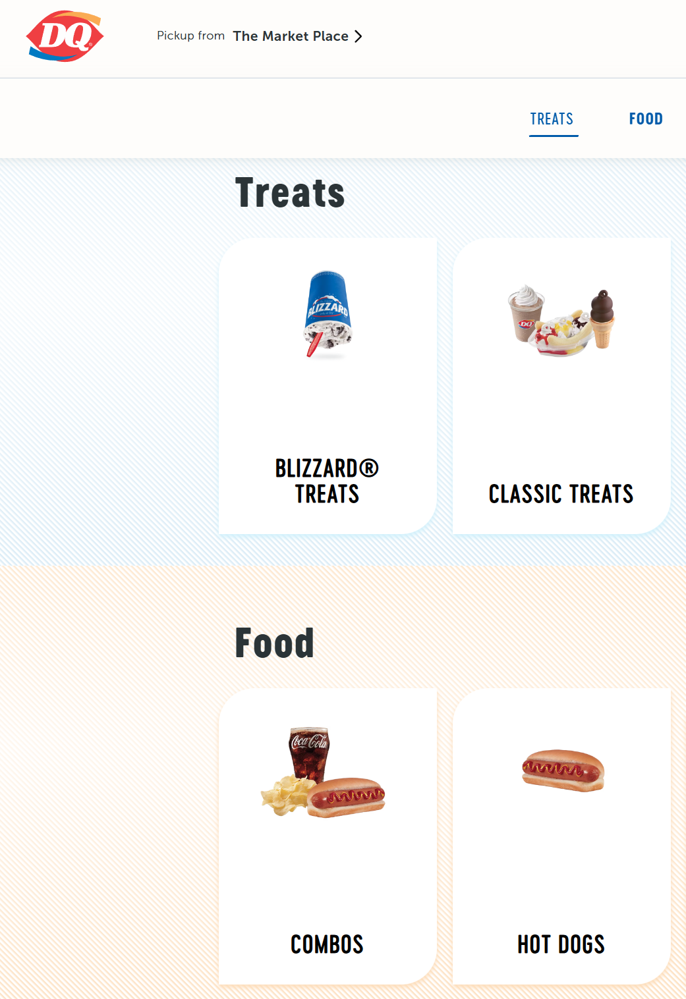
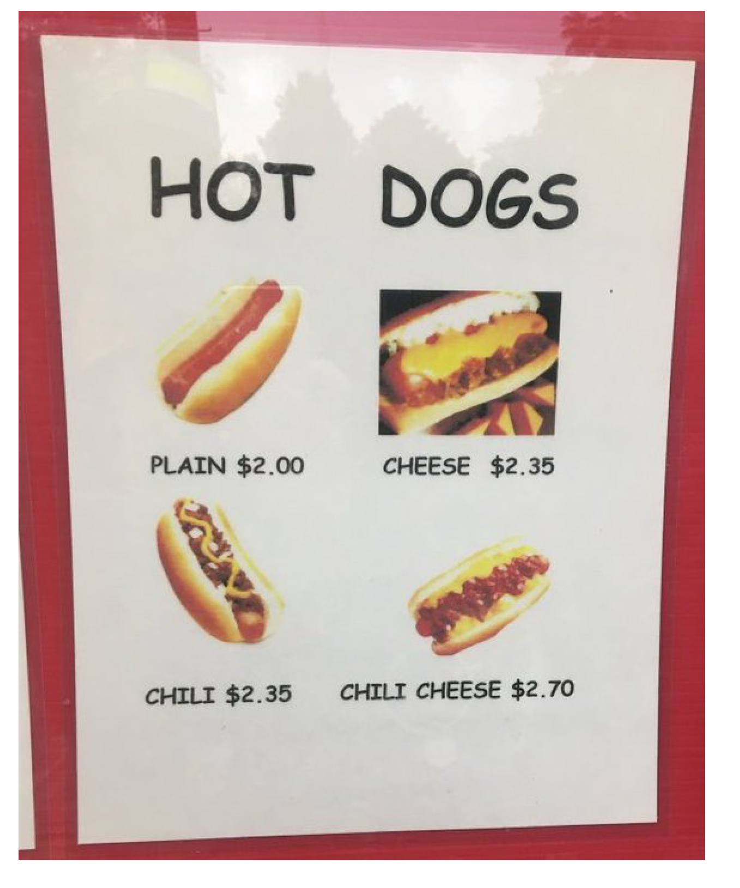

```{r setup, include=FALSE}
knitr::opts_chunk$set(warning = FALSE, message = FALSE, echo = FALSE,
                      fig.retina = 3, fig.align = "center",
                      dev = "ragg_png")  # ragg finds Fira Sans Condensed on Windows
```

```{r packages-data, include=FALSE}
library(tidyverse)
library(knitr)
source(here::here("R", "slide-things.R"))

# Colors from the slide theme, all readable on white ----
clr_bar <- "#538ba2"
clr_soft <- "#c5d9e2"
clr_mean <- "#a93e31"
clr_median <- "#244a70"
clr_mode <- "#8a6100"

theme_slides <- function(base_size = 20) {
  theme_minimal(base_size = base_size, base_family = "Fira Sans Condensed") +
    theme(panel.grid.minor = element_blank(),
          panel.grid.major.x = element_blank(),
          axis.title = element_text(face = "bold"),
          strip.text = element_text(face = "bold", size = rel(1)))
}

fmt <- function(x, d = 2) str_replace(formatC(if_else(round(x, d) == 0, 0, x), format = "f", digits = d), "-", "−")
comma <- function(x, d = 2) formatC(x, format = "f", digits = d, big.mark = ",")
pct <- function(x, d = 0) paste0(fmt(100 * x, d), "%")
p_text <- function(p) if (p < 0.001) "p < 0.001" else paste("p =", fmt(p, 3))
term <- function(x, d = 2) paste(if_else(x < 0, "−", "+"), fmt(abs(x), d))  # "+ 3.58" or "− 0.03"

label_text <- function(x, y, label, color = clr_median, hjust = 0.5, size = 6.5) {
  annotate("text", x = x, y = y, label = label, color = color, hjust = hjust, size = size,
           fontface = "bold", family = "Fira Sans Condensed")
}

# Mindspark math scores. Everyone at endline also has a baseline score ----
baseline <- read_csv(here::here("files", "data", "mindspark", "ms_blel_jpal_baseline.csv"),
                     show_col_types = FALSE)
endline <- read_csv(here::here("files", "data", "mindspark", "ms_blel_jpal_endline.csv"),
                    show_col_types = FALSE)
students <- transmute(baseline, baseline_math = tot_math, center = ms_center1)
mindspark <- inner_join(select(baseline, st_id, baseline_math = tot_math),
                        select(endline, st_id, endline_math = tot_math, treat, female = st_female1,
                               center = ms_center1, tuition = st_tui_math),
                        by = "st_id") %>%
  mutate(gain = endline_math - baseline_math)
n_all <- nrow(mindspark)

# Block 1: Topic 10's ANOVA, run as a regression ----
fit_center <- lm(baseline_math ~ center, data = students)
center_ctab <- coef(summary(fit_center))
center_aov <- anova(fit_center)
center_means <- students %>%
  group_by(center) %>%
  summarize(n = n(), M = mean(baseline_math))
center_reg <- list(ss = center_aov$`Sum Sq`[1], df = center_aov$Df[1], ms = center_aov$`Mean Sq`[1],
                   f = center_aov$`F value`[1], p = center_aov$`Pr(>F)`[1])
center_res <- list(ss = center_aov$`Sum Sq`[2], df = center_aov$Df[2], ms = center_aov$`Mean Sq`[2])
center_total <- center_reg$ss + center_res$ss
center_r2 <- summary(fit_center)$r.squared

# Check it against ANOVA's own arithmetic, from Topic 10
overall <- mean(students$baseline_math)
ss_between <- sum(center_means$n * (center_means$M - overall)^2)
ss_within <- students %>%
  group_by(center) %>%
  summarize(ss = sum((baseline_math - mean(baseline_math))^2)) %>%
  pull(ss) %>%
  sum()
stopifnot(all.equal(ss_between, center_reg$ss), all.equal(ss_within, center_res$ss))

# Block 1: Topic 9's t-test, run as a regression ----
fit_treat <- lm(endline_math ~ treat, data = mindspark)
treat_ctab <- coef(summary(fit_treat))
treat_sum <- summary(fit_treat)
treat <- list(a = treat_ctab[1, 1], b = treat_ctab[2, 1], se = treat_ctab[2, 2], t = treat_ctab[2, 3],
              p = treat_ctab[2, 4], df = fit_treat$df.residual, f = treat_sum$fstatistic[["value"]],
              r2 = treat_sum$r.squared, sd = sigma(fit_treat), ci = confint(fit_treat)["treat", ])
treat$g <- treat$b / treat$sd
treat$r <- cor(mindspark$treat, mindspark$endline_math)
treat$t_r <- treat$r / sqrt((1 - treat$r^2) / treat$df)

# Check it against the two-sample t, from Topic 9
pooled_t <- t.test(endline_math ~ treat, mindspark, var.equal = TRUE)
stopifnot(all.equal(abs(unname(pooled_t$statistic)), treat$t),
          all.equal(unname(pooled_t$stderr), treat$se),
          all.equal(treat$t_r, treat$t),
          all.equal(treat$t^2, treat$f))
m_control <- treat$a
m_treated <- treat$a + treat$b

# Block 1's try-it: one center ----
chhatarpur <- filter(mindspark, center == "Chhatarpur")
fit_chh <- lm(endline_math ~ treat, data = chhatarpur)
chh_ctab <- coef(summary(fit_chh))
chh_df <- fit_chh$df.residual
chh_all <- map_dbl(c("Chhatarpur", "Govindpuri", "Tekhand"),
                   ~ coef(lm(endline_math ~ treat, data = filter(mindspark, center == .x)))[["treat"]])

# The simulator's world. Its spread around the line is 1, so d is the gap in SDs ----
sim_n <- 20
sim_a <- 3
sim_d <- round(treat$g, 2)
sim_df <- sim_n - 2
sim_seed <- 43  # Its last sample lands on the true gap, so panel 2 shows a typical line

# Block 2: prices, from the 2024 slides. The discount is made up ----
price_plain <- 2.00
price_each <- 0.35
price_combo <- 2.50
prices <- bind_rows(
  tibble(panel = "No interaction: the lines are parallel", chili = rep(c("No chili", "Chili"), each = 2),
         cheese = rep(c("No cheese", "Cheese"), 2), x = rep(0:1, 2),
         price = price_plain + price_each * c(0, 1, 1, 2)),
  tibble(panel = "Interaction: they aren't", chili = rep(c("No chili", "Chili"), each = 2),
         cheese = rep(c("No cheese", "Cheese"), 2), x = rep(0:1, 2),
         price = c(price_plain, price_plain + price_each, price_plain + price_each, price_combo))
) %>%
  mutate(panel = fct_inorder(panel))

# Block 2: the 2 × 2 ----
fit_int <- lm(endline_math ~ treat * female, data = mindspark)
int_ctab <- coef(summary(fit_int))
int <- list(a = int_ctab[1, 1], b1 = int_ctab[2, 1], b2 = int_ctab[3, 1], b3 = int_ctab[4, 1],
            se = int_ctab[4, 2], t = int_ctab[4, 3], p = int_ctab[4, 4], df = fit_int$df.residual,
            ci = confint(fit_int)["treat:female", ], crit = qt(0.975, fit_int$df.residual))
int_line <- paste0("Ŷ = ", fmt(int$a), " ", term(int$b1, 3), " treat ", term(int$b2), " female ",
                   term(int$b3, 3), " treat×female")
cells <- mindspark %>%
  group_by(treat, female) %>%
  summarize(n = n(), M = mean(endline_math), .groups = "drop")
cell <- function(tr, fe, what = "M") cells[[what]][cells$treat == tr & cells$female == fe]
eff_boys <- cell(1, 0) - cell(0, 0)
eff_girls <- cell(1, 1) - cell(0, 1)
n_boys <- sum(mindspark$female == 0)
stopifnot(all.equal(int$a + int$b1 + int$b2 + int$b3, cell(1, 1)))
t_boys <- coef(summary(lm(endline_math ~ treat, data = filter(mindspark, female == 0))))[2, 3]
t_girls <- coef(summary(lm(endline_math ~ treat, data = filter(mindspark, female == 1))))[2, 3]

# Block 2's game: Mindspark and math tuition ----
fit_tui <- lm(endline_math ~ treat * tuition, data = mindspark)
tui_ctab <- coef(summary(fit_tui))
tui <- list(a = tui_ctab[1, 1], b1 = tui_ctab[2, 1], b2 = tui_ctab[3, 1], b3 = tui_ctab[4, 1],
            t = tui_ctab[4, 3], p = tui_ctab[4, 4], df = fit_tui$df.residual)

# Block 3: same gap, adding one predictor at a time ----
fit_gender <- lm(endline_math ~ treat + female, data = mindspark)
fit_base <- lm(endline_math ~ treat + baseline_math, data = mindspark)
fit_gain <- lm(gain ~ treat, data = mindspark)
row_of <- function(fit) {
  co <- coef(summary(fit))["treat", ]
  list(b = co[["Estimate"]], se = co[["Std. Error"]], t = co[["t value"]], miss = sigma(fit))
}
m_treat <- row_of(fit_treat)
m_gender <- row_of(fit_gender)
m_base <- row_of(fit_base)
m_gain <- row_of(fit_gain)
slope_base <- coef(fit_base)[["baseline_math"]]
base_gap <- with(mindspark, mean(baseline_math[treat == 0]) - mean(baseline_math[treat == 1]))
base_gap_p <- t.test(baseline_math ~ treat, mindspark, var.equal = TRUE)$p.value
r_base <- cor(mindspark$baseline_math, mindspark$endline_math)
r_gender <- cor(mindspark$female, mindspark$endline_math)
stopifnot(all.equal(m_treat$b + slope_base * base_gap, m_base$b),
          all.equal(m_treat$b + base_gap, m_gain$b))

# Two made-up groups for the picture of spread ----
toy <- expand_grid(group = c("Control", "Program"), offset = -3:3) %>%
  mutate(center = if_else(group == "Control", 10, 14))
toy_all <- bind_rows(mutate(toy, score = center + 2 * offset, spread = "Much spread within groups"),
                     mutate(toy, score = center + 0.5 * offset, spread = "Little spread within groups")) %>%
  mutate(spread = fct_inorder(spread))
toy_means <- distinct(toy_all, spread, group, center)

# Who left the study ----
kept <- tibble(treat = baseline$treat, there = baseline$st_id %in% endline$st_id)
kept_rate <- tapply(kept$there, kept$treat, mean)
kept_p <- chisq.test(table(kept$treat, kept$there))$p.value

# Gains, for the closing story ----
gain_t <- mean(mindspark$gain[mindspark$treat == 1])
gain_c <- mean(mindspark$gain[mindspark$treat == 0])

# Baseline as the only predictor, from Topic 13 ----
fit_all <- lm(endline_math ~ baseline_math, data = mindspark)
all_ctab <- coef(summary(fit_all))

# R's output, as students saw it in Topic 13 ----
# These characters would otherwise be read as HTML or markdown
safe_text <- function(x) {
  x %>%
    str_replace_all("\t", "  ") %>%
    str_replace_all("&", "&amp;") %>%
    str_replace_all("<", "&lt;") %>%
    str_replace_all(">", "&gt;") %>%
    str_replace_all("\\*", "&#42;") %>%
    str_replace_all("_", "&#95;") %>%
    str_replace_all("-", "&#45;")
}

# Each line is its own div on one long line, so remark can't read "---" as a new slide
r_block <- function(lines, notes = NULL, width = 58) {
  shown <- str_pad(lines, width, "right")
  shown <- safe_text(shown)
  for (pattern in names(notes)) {
    i <- str_which(lines, pattern)[1]
    shown[i] <- paste0(shown[i], '<span class="r-note">← ', notes[[pattern]], "</span>")
  }
  shown[str_trim(lines) == ""] <- "&nbsp;"
  cat('<div class="r-output">', paste0("<div>", shown, "</div>", collapse = ""), "</div>\n", sep = "")
}

# Just the lines we read: the call, the table and the last lines
r_short <- function(fit, f_line = TRUE) {
  old <- options(width = 80)
  on.exit(options(old))
  out <- str_replace_all(capture.output(print(summary(fit))), "\t", " ")
  keep <- str_detect(out, "^lm\\(|Estimate|^\\(Intercept\\)|^center|^treat|^female|^tuition|^Residual standard|^Multiple")
  if (f_line) keep <- keep | str_detect(out, "^F-statistic")
  out[keep]
}
```

```{r xaringanExtra, echo=FALSE}
xaringanExtra::use_xaringan_extra(c("tile_view"))
```

class: center middle main-title section-title-4

# Regression: groups and interactions

.class-info[

**Topic 14 · Thursday, March 11**

.light[EDUC 15: Statistics for Education Research<br>
UCI School of Education
]

]

---

class: title title-8

# Where are we?

.pull-left-3[
.box-1.medium[Description]

.box-inv-1.small[Summarize data]

.box-inv-1.small[Visualize data]
]

.pull-middle-3[
.box-6.medium[Prediction]

.box-inv-6.small[Do these groups differ?]

.box-inv-6.small[Does one score go with another?]

.box-inv-6.small[Is the slope real?]
]

.pull-right-3[
.box-3.medium[Explanation]

.box-inv-3.small[Did the program cause it?]

.center[**We are here**]

.anteater[]
]

.source[Peter the Anteater at a UC Irvine basketball game.]

???

Same map, last time. Today the third column finally fills in. This is the last new content of the quarter, and it pulls the course together: ANOVA, the t-test and the Mindspark study all turn out to live inside one regression.

---

name: outline
class: title title-8

# Plan for today

.box-1.medium.sp-after-half[ANOVA and t-tests are regression]

.box-6.medium.sp-after-half[Interactions]

.box-3.medium.sp-after-half[A sharper test, and the word "caused"]

???

Three blocks of about 20 minutes. Each ends with students doing something: try, play, predict. Nothing here adds a new formula to compute by hand. It's about reading output and saying what it means.

---

layout: false
class: center middle section-title section-title-1 animated fadeIn

# ANOVA and t-tests are regression

---

layout: true
class: title title-1

---

# A center is a name, not a number

.box-inv-1.small[Regression needs numbers, so we turn each center into yes/no columns]

```{r columns-table, results="asis"}
tribble(
  ~`A student in`, ~`Govindpuri?`, ~`Tekhand?`,
  "Chhatarpur", "0", "0",
  "Govindpuri", "1", "0",
  "Tekhand", "0", "1"
) %>%
  kable(format = "html", align = "lcc", table.attr = 'class="deck-table tight"')
```

<div class="math-display">\[
\hat{Y} = a + b_1 \times \text{Govindpuri} + b_2 \times \text{Tekhand}
\]</div>

.box-1.small[Three groups need two columns: k − 1, which is ANOVA's df between]

.book-tag[The book stops at one predictor. The handout on this topic's page covers two or more]

???

Tuesday ended with "regression plays the part of between, and residual plays the part of within." So can a line do ANOVA's whole job? The one thing in the way is that a center is a name.

Why not a third column for Chhatarpur? It would add nothing: a student with 0 and 0 must be in Chhatarpur. That group with all zeros is the reference group. The word for such a column is a dummy variable, or an indicator.

Each b now has its own column, so each gets a number. b₁ and b₂ are still estimates, of β₁ and β₂.

---

# Each row is a mean or a gap

```{r center-output, results="asis"}
r_block(r_short(fit_center), list("^\\(Intercept\\)" = "a: Chhatarpur's mean",
                                  "^centerGovindpuri" = "Govindpuri − Chhatarpur",
                                  "^centerTekhand" = "Tekhand − Chhatarpur",
                                  "^Residual standard" = "√MS<sub>within</sub>",
                                  "^F-statistic" = "Topic 10's F"), width = 60)
```

.box-1.small.sp-after-half[Start at a and add each gap: `r fmt(center_ctab[1, 1])` − `r fmt(abs(center_ctab[2, 1]))` = `r fmt(center_ctab[1, 1] + center_ctab[2, 1])`, and `r fmt(center_ctab[1, 1])` − `r fmt(abs(center_ctab[3, 1]))` = `r fmt(center_ctab[1, 1] + center_ctab[3, 1])`]

.box-inv-1.small[Those are Topic 10's three means. With yes/no columns, every row is about groups]

.source[Data: Muralidharan, Singh, and Ganimian (2019). All `r nrow(students)` students at baseline. Output from R, `summary(lm())`.]

???

The last row's t, `r fmt(center_ctab[3, 3])`, is Topic 10's try-it: Chhatarpur against Tekhand, with the same gap, the same MS within and the same df. Its p of `r fmt(center_ctab[3, 4], 3)` is the same too, and it needs the same Bonferroni care.

To compare Govindpuri with Tekhand, change which center is the reference. Nothing else about the model changes.

Each row has a t, and the F at the bottom tests all the b's together. That's the point Tuesday's notes made: with more than one predictor, F and t are no longer the same number.

---

# Same split, same F

```{r same-table, results="asis"}
tribble(
  ~`In Topic 10`, ~`In regression`, ~SS, ~df, ~MS, ~F,
  "Between centers", "Regression", comma(center_reg$ss), as.character(center_reg$df), comma(center_reg$ms), paste0("<strong>", fmt(center_reg$f), "</strong>"),
  "Within centers", "Residual", comma(center_res$ss), as.character(center_res$df), comma(center_res$ms), " ",
  "Total", "Total", comma(center_total), as.character(center_reg$df + center_res$df), " ", " "
) %>%
  kable(format = "html", escape = FALSE, align = "llcccc", table.attr = 'class="deck-table"')
```

.box-inv-1.small.sp-after-half[Same numbers, to the last decimal: F(`r center_reg$df`, `r center_res$df`) = `r fmt(center_reg$f)`, `r p_text(center_reg$p)`]

.box-inv-1.small.sp-after-half[Topic 10's η̂² = `r fmt(center_r2, 3)` is R's Multiple R-squared]

.box-1.small[A one-way ANOVA is a regression on yes/no columns]

.book-tag[With more than one predictor, r² is written R²]

.source[Data: Muralidharan, Singh, and Ganimian (2019).]

???

Nothing here is rounded or approximate. The group means are Ŷ, so SS residual is every student's distance from their own center's mean, and that's SS within.

ANOVA and regression grew up in different fields, so they use different words. It's one model.

---

# With two groups, one column will do

```{r treat-plot, fig.width=10, fig.height=4.1, out.width="80%", fig.alt=paste0("Dots for ", n_all, " students' endline math scores in two columns, at X = 0 for control and X = 1 for Mindspark. A red diamond marks each group's mean: ", fmt(m_control), " and ", fmt(m_treated), ". A straight line joins the two diamonds, and its slope is ", fmt(treat$b), ".")}
ggplot(mindspark, aes(x = treat, y = endline_math)) +
  geom_point(position = position_jitter(width = 0.1, height = 0.25, seed = 15), color = clr_bar, alpha = 0.45, size = 2.2) +
  annotate("segment", x = 0, xend = 1, y = m_control, yend = m_treated, color = clr_median, linewidth = 1.6) +
  annotate("point", x = c(0, 1), y = c(m_control, m_treated), color = clr_mean, shape = 18, size = 9) +
  label_text(-0.17, m_control, paste("a =", fmt(m_control)), clr_mean, hjust = 1) +
  label_text(1.17, m_treated, paste("a + b =", fmt(m_treated)), clr_mean, hjust = 0) +
  label_text(0.5, m_control - 3, paste("b =", fmt(treat$b)), clr_median) +
  scale_x_continuous(breaks = c(0, 1), labels = c("X = 0: control", "X = 1: Mindspark"), limits = c(-0.5, 1.5)) +
  scale_y_continuous(breaks = seq(0, 32, 8)) +
  labs(x = NULL, y = "Math score at endline") +
  theme_slides()
```

.box-1.small[X can only be 0 or 1, so the line joins two means. Its slope is the gap]

.source[Data: Muralidharan, Singh, and Ganimian (2019). `r n_all` students. Dots are nudged so equal scores don't hide each other.]

???

Same picture as Topic 12, with only two places for X to be. The least squares line must go through both group means, since each mean is what minimizes squares within its own column.

So a is the control group's mean and b is the gap. Nothing else is possible.

---

# The slope is Topic 9's gap

```{r treat-output, results="asis"}
r_block(r_short(fit_treat), list("^\\(Intercept\\)" = "a: the control mean",
                                 "^treat" = "b: the gap, and its σ̂",
                                 "^Residual standard" = "√pooled variance",
                                 "^Multiple" = "r²",
                                 "^F-statistic" = "F = t²"), width = 64)
```

.pull-left[
.box-inv-1.small[Ŷ = `r fmt(treat$a)` + `r fmt(treat$b)`X. At X = 0, Ŷ = `r fmt(m_control)`]
]

.pull-right[
.box-inv-1.small[At X = 1, Ŷ = `r fmt(treat$a)` + `r fmt(treat$b)` = `r fmt(m_treated)`]
]

.box-1.small[The Std. Error, `r fmt(treat$se, 3)`, is Topic 9's σ̂<sub>M₁−M₂</sub>. The t, `r fmt(treat$t)`, is Topic 9's t]

.source[Data: Muralidharan, Singh, and Ganimian (2019). Output from R, `summary(lm())`.]

???

`r fmt(m_control)` and `r fmt(m_treated)` are the two numbers from the first week of class. In Topic 1 we asked if that gap was real or just luck.

Sign: Topic 9 subtracted control from Mindspark, so its t was positive too. If R ran `t.test()`, it would subtract the other way, and print −`r fmt(treat$t)`. Only the sign changes.

This t is the pooled t, because regression assumes one spread around the line. That's the same assumption.

---

# One gap, four tests, one answer

```{r one-gap, results="asis"}
tribble(
  ~`Test of the gap`, ~`Where we met it`, ~`Mindspark at endline`,
  "Two-sample t", "Topic 9", paste0("t(", treat$df, ") = ", fmt(treat$t)),
  "One-way ANOVA", "Topic 10", paste0("F(1, ", treat$df, ") = ", fmt(treat$f)),
  "Correlation with a yes/no X", "Topic 11", paste0("r = ", fmt(treat$r), ", t(", treat$df, ") = ", fmt(treat$t_r)),
  "<strong>Regression slope</strong>", "<strong>Today</strong>", paste0("<strong>b = ", fmt(treat$b), ", t(", treat$df, ") = ", fmt(treat$t), "</strong>")
) %>%
  kable(format = "html", escape = FALSE, align = "llc", table.attr = 'class="deck-table"')
```

.box-inv-1.small.sp-after-half[`r fmt(treat$t)`² = `r fmt(treat$f)`. And r² = `r fmt(treat$r2, 3)` is the share of variability between the groups]

.box-1.small[The book teaches these one at a time. They're one model: regression]

.source[Data: Muralidharan, Singh, and Ganimian (2019).]

???

This is the slide to linger on. Students learned these as four tests, and each has its own formula. All of them ask: how much better do we predict Y when we know which group someone is in?

Each still earns its place: the t-test is the simple hand calculation, ANOVA handles many groups at once, r gives a scale-free size, and regression lets us add more predictors, which is the rest of today.

---

# Step 7b: a slope for a yes/no X

```{r sim-binary, results="asis"}
sim_frame(
  alt = paste0("Simulator at step 7b with 551 samples of ", sim_n, " people, half at X = 0 and half at X = 1. Panel 1 shows two curves for the two groups, joined by the population line Y = ", fmt(sim_a), " + ", fmt(sim_d), " X. Panel 2 shows one sample as two columns of dots with a line through the two group means. Panel 3 shows the values of b piled up around ", fmt(sim_d), "."),
  step = "7b", n = sim_n, d = sim_d, a = sim_a, view = "raw", draws = 551, seed = sim_seed, height = 495
)
```

.source[Simulator after Kristoffer Magnusson, rpsychologist.com. On your phone: [the simulator page](https://educ15.de-barros.com/resource/simulator.html).]

???

The last step on the blueprint, and the same three panels as always. Panel 1 has two groups, so the population line joins two means. Panel 2 is one sample of `r sim_n`. Panel 3 piles up each sample's b, which is each sample's gap.

**Press +1 a few times** and watch the line swing, as it did on Tuesday.

The slope β = `r fmt(sim_d)` is about Mindspark's gap in SDs, since the spread around this line is 1. The population line is in plain numbers, not points on our test.

---

# Under H₀, it's step 4's t curve

```{r sim-binary-null, results="asis"}
sim_frame(
  alt = paste0("Simulator at step 7b with 551 samples of ", sim_n, " people and a flat population line, so the two groups have the same mean. Panel 3 shows t values stacked along a t curve with ", sim_df, " degrees of freedom, with cutoffs near plus and minus ", fmt(qt(0.975, sim_df)), "."),
  step = "7b", n = sim_n, d = 0, a = sim_a, view = "stat", draws = 551, seed = sim_seed, height = 495
)
```

.source[Simulator after Kristoffer Magnusson, rpsychologist.com.]

???

Here β = 0, so H₀ is true. Topic 9 did this with step 4: 10 people per group, so t(`r sim_df`). Step 7b has `r sim_n` people and df = n − 2 = `r sim_df`. Same curve, same cutoffs of ±`r fmt(qt(0.975, sim_df), 3)`, and the same 5% beyond them.

The blueprint began as a picture of one mean. It ends with a line, and that line is the same test.

---

layout: false
class: title title-8

# Try it: One center's output

```{r try-output, results="asis"}
r_block(r_short(fit_chh, f_line = FALSE), width = 64)
```

.box-8.small.sp-after-half[These are Chhatarpur's `r nrow(chhatarpur)` students, with treat = 0 or 1. Find the control mean, the Mindspark mean and F]

.box-inv-8.small[Then decide with α = 0.05. Work alone, compare with a neighbor, then vote with hands: reject or maintain?]

.source[Data: Muralidharan, Singh, and Ganimian (2019). Output from R, `summary(lm())`.]

???

About 6 minutes. No calculator needed except for the squaring. The F-statistic line is hidden on purpose.

---

class: title title-8

# Try it: Answer

.pull-left-3[
.box-inv-8.small[Control mean: a = **`r fmt(chh_ctab[1, 1])`**]
]

.pull-middle-3[
.box-inv-8.small[Mindspark mean: a + b = **`r fmt(chh_ctab[1, 1] + chh_ctab[2, 1])`**]
]

.pull-right-3[
.box-inv-8.small[F = t² = `r fmt(chh_ctab[2, 3])`² = **`r fmt(chh_ctab[2, 3]^2)`**]
]

.box-8.small.sp-after-half[p = `r fmt(chh_ctab[2, 4], 3)` is above 0.05, so we **maintain H₀**: t(`r chh_df`) = `r fmt(chh_ctab[2, 3])`]

.box-inv-8.small.sp-after-half[With only `r nrow(chhatarpur)` students, this gap's standard error is `r fmt(chh_ctab[2, 2])`, not `r fmt(treat$se)`]

.box-inv-8.small[Maintaining H₀ doesn't mean no effect here. And a gap of `r fmt(chh_ctab[2, 1])` isn't `r fmt(treat$b)`. Could the effect depend on who you are?]

.source[Data: Muralidharan, Singh, and Ganimian (2019).]

???

Common slip: reading the intercept's p, which is about something else.

The gaps by center are `r fmt(chh_all[1])`, `r fmt(chh_all[2])` and `r fmt(chh_all[3])`. They bounce, as gaps do. Telling a bounce from a real difference is the next block's job.

---

layout: false
class: center middle section-title section-title-6 animated fadeIn

# Interactions

---

layout: true
class: title title-6

---

# Dairy Queen sells hot dogs

.pull-left[
.picture[]
]

.pull-right[
.picture[]
]

.source[Menu and sign: Dairy Queen.]

???

Do we have to pay extra for this culinary synergy?

---

# Does chili cheese cost extra?

```{r price-table, results="asis"}
tribble(
  ~` `, ~`No cheese`, ~Cheese,
  "No chili", paste0("$", fmt(price_plain)), paste0("$", fmt(price_plain + price_each)),
  "Chili", paste0("$", fmt(price_plain + price_each)), paste0("$", fmt(price_plain + 2 * price_each))
) %>%
  kable(format = "html", align = "lcc", table.attr = 'class="deck-table"')
```

.pull-left[
.box-inv-6.small[Chili alone adds $`r fmt(price_each)`. Cheese alone adds $`r fmt(price_each)`]
]

.pull-right[
.box-inv-6.small[Both together add $`r fmt(2 * price_each)`: the sum of the two]
]

.box-6.small[An **interaction** is what a combination adds beyond the sum of its parts. Here, it's $0]

???

A menu, from the 2024 lecture. Take a minute with it: what's the chili effect? The cheese effect? The chili and cheese effect? Do we pay extra for this synergy?

So the whole is exactly the sum of its parts. The effect of chili doesn't depend on whether you ordered cheese.

---

# Parallel lines mean no interaction

```{r parallel-plot, fig.width=11, fig.height=4, out.width="90%", fig.alt=paste0("Two line charts of price against cheese, with one line for no chili and one for chili. In the left panel, both lines rise by the same amount, so they are parallel: $", fmt(price_plain), " to $", fmt(price_plain + price_each), ", and $", fmt(price_plain + price_each), " to $", fmt(price_plain + 2 * price_each), ". In the right panel, a made-up discount sets chili cheese at $", fmt(price_combo), ", so the chili line rises less and the two lines come together.")}
price_ends <- filter(prices, x == 1)

ggplot(prices, aes(x = x, y = price, color = chili, linetype = chili)) +
  geom_line(linewidth = 1.5) +
  geom_point(size = 4.5) +
  geom_text(data = price_ends, aes(label = paste0(chili, ": $", fmt(price))), nudge_x = 0.05, hjust = 0, size = 6,
            fontface = "bold", family = "Fira Sans Condensed", show.legend = FALSE) +
  facet_wrap(vars(panel), nrow = 1) +
  scale_color_manual(values = c(Chili = clr_mean, `No chili` = clr_median), guide = "none") +
  scale_linetype_manual(values = c(Chili = "solid", `No chili` = "dashed"), guide = "none") +
  scale_x_continuous(breaks = 0:1, labels = c("No cheese", "Cheese"), limits = c(-0.15, 1.75)) +
  scale_y_continuous(labels = ~ paste0("$", fmt(.x)), limits = c(1.95, 2.8)) +
  labs(x = NULL, y = "Price") +
  theme_slides(18) +
  theme(panel.spacing.x = unit(1.5, "lines"))
```

.box-6.small[On the right, what chili adds depends on whether you have cheese]

.source[The right-hand price of $`r fmt(price_combo)` is made up.]

???

The left panel is the real menu. Parallel lines mean that the gap between them stays the same all the way across.

The right panel is a made-up combo discount. Now the sum of the parts is $`r fmt(price_plain + 2 * price_each)`, and the combination costs $`r fmt(price_combo)`, so the interaction is −$`r fmt(price_plain + 2 * price_each - price_combo)`. It can go either way: extra or muted.

Lines don't need to cross for there to be an interaction. They only need to not be parallel.

---

# Mindspark's lines aren't quite parallel

```{r mindspark-lines, fig.width=10, fig.height=4, out.width="80%", fig.alt=paste0("Line chart of mean endline math. Boys rise from ", fmt(cell(0, 0)), " in control to ", fmt(cell(1, 0)), " with Mindspark. Girls rise from ", fmt(cell(0, 1)), " to ", fmt(cell(1, 1)), ". The two lines start at almost the same point, and the boys' line ends a little higher, so they are not quite parallel.")}
cell_plot <- cells %>%
  mutate(group = if_else(female == 1, "Girls", "Boys"))

ggplot(cell_plot, aes(x = treat, y = M, color = group, linetype = group)) +
  geom_line(linewidth = 1.5) +
  geom_point(size = 4.5) +
  label_text(1.03, cell(1, 0) + 0.1, paste0("Boys: ", fmt(cell(1, 0)), ", up ", fmt(eff_boys)), clr_mean, hjust = 0) +
  label_text(1.03, cell(1, 1) - 0.1, paste0("Girls: ", fmt(cell(1, 1)), ", up ", fmt(eff_girls)), clr_median, hjust = 0) +
  label_text(-0.03, cell(0, 0) + 0.45, paste("Boys:", fmt(cell(0, 0))), clr_mean, hjust = 1) +
  label_text(-0.03, cell(0, 1) - 0.45, paste("Girls:", fmt(cell(0, 1))), clr_median, hjust = 1) +
  scale_color_manual(values = c(Boys = clr_mean, Girls = clr_median), guide = "none") +
  scale_linetype_manual(values = c(Boys = "solid", Girls = "dashed"), guide = "none") +
  scale_x_continuous(breaks = 0:1, labels = c("Control", "Mindspark"), limits = c(-0.3, 1.55)) +
  scale_y_continuous(limits = c(15, 20.5), breaks = 15:20) +
  labs(x = NULL, y = "Mean math score at endline") +
  theme_slides()
```

.box-6.small[The gap is `r fmt(eff_boys)` for boys and `r fmt(eff_girls)` for girls. Is that `r fmt(eff_boys - eff_girls)`-point difference real?]

.source[Data: Muralidharan, Singh, and Ganimian (2019). Boys: `r cell(0, 0, "n")` control, `r cell(1, 0, "n")` Mindspark. Girls: `r cell(0, 1, "n")` control, `r cell(1, 1, "n")` Mindspark.]

???

The old two-factor ANOVA question: does the program's effect vary by gender?

A sample's lines are never perfectly parallel, just as two sample means are never perfectly equal. So we need a test.

---

# An interaction is one more column

```{r product-table, results="asis"}
tribble(
  ~Group, ~treat, ~female, ~`treat × female`, ~n,
  "Control boys", "0", "0", "0", as.character(cell(0, 0, "n")),
  "Mindspark boys", "1", "0", "0", as.character(cell(1, 0, "n")),
  "Control girls", "0", "1", "0", as.character(cell(0, 1, "n")),
  "Mindspark girls", "1", "1", "<strong>1</strong>", as.character(cell(1, 1, "n"))
) %>%
  kable(format = "html", escape = FALSE, align = "lcccc", table.attr = 'class="deck-table tight"')
```

<div class="math-display">\[
\hat{Y} = a + b_1 \,\text{treat} + b_2 \,\text{female} + b_3 \,(\text{treat} \times \text{female})
\]</div>

.box-6.small[The product is 1 for one group only. So b₃ is the extra for that group]

.source[Data: Muralidharan, Singh, and Ganimian (2019).]

???

This is the idea of a two-factor design, and it's still just columns. Regression doesn't need a new method for two factors.

Four groups, four numbers: a, b₁, b₂ and b₃. So the model fits all four means exactly. The next slides show how to get them back.

We skip the two-factor partition of SS on purpose. With unequal group sizes it isn't a simple hand calculation, and a table of results tells us all we need.

---

# R writes the product as treat:female

```{r int-output, results="asis"}
r_block(r_short(fit_int), list("^\\(Intercept\\)" = "a",
                               "^treat " = "b₁",
                               "^female" = "b₂",
                               "^treat:female" = "b₃"), width = 64)
```

.box-6.small.sp-after-half[`r int_line`]

.box-inv-6.small[Read the four coefficients as groups. Don't start with the stars]

.source[Data: Muralidharan, Singh, and Ganimian (2019). Output from R, `summary(lm())`.]

???

Point out that the `treat` row's t is `r fmt(int_ctab[2, 3])`, smaller than the `r fmt(treat$t)` from before. That isn't a weaker effect. It's a different question, as the next slide shows.

With a product in the model, the F at the bottom tests all three b's at once. We don't use it here.

---

# Each coefficient compares two groups

```{r meaning-table, results="asis"}
tribble(
  ~` `, ~Value, ~`What it says`,
  "a", fmt(int$a), "The mean of control boys, where every column is 0",
  "b₁: treat", fmt(int$b1, 3), "Mindspark's effect <strong>for boys</strong>, where female = 0",
  "b₂: female", fmt(int$b2), "Girls minus boys <strong>in the control group</strong>",
  "b₃: treat × female", fmt(int$b3, 3), "How much smaller the effect is for girls"
) %>%
  kable(format = "html", escape = FALSE, align = "lcl", table.attr = 'class="deck-table tight"')
```

.box-inv-6.small.sp-after-half[Mindspark girls: `r fmt(int$a)` + `r fmt(int$b1, 3)` − `r fmt(abs(int$b2))` − `r fmt(abs(int$b3), 3)` = `r fmt(cell(1, 1))`. Every column is 1, so add all four]

.box-6.small[With a product in the model, each b holds where the other column is 0]

.book-tag[You'll also read: moderation, or heterogeneous, conditional or differential effects]

.source[Data: Muralidharan, Singh, and Ganimian (2019).]

???

The trap is reading `r fmt(int$b1, 3)` as "the effect of Mindspark". It's the effect for boys. For girls it's `r fmt(int$b1, 3)` − `r fmt(abs(int$b3), 3)` = `r fmt(eff_girls)`.

The three t's answer three questions, a little different from a two-factor ANOVA's, whose main effects are averages across groups. The interaction test is the same: `r fmt(int$t)`² = `r fmt(int$t^2)`, the F from 2024.

Students don't need the other names on the last line for exams, but they'll see them in papers.

---

# The four steps: is the interaction real?

```{r int-steps, results="asis"}
tribble(
  ~Step, ~`In words`, ~`Our numbers`,
  "1. State H₀", "Same effect for girls and boys", "H₀: β₃ = 0",
  "2. Set the criteria", "Two tails, α = 0.05", paste0("t(", int$df, ") beyond ±", fmt(int$crit, 3)),
  "3. Compute t", "Estimate / Std. Error", paste0(fmt(int$b3, 3), " / ", fmt(int$se, 3), " = ", fmt(int$t)),
  "4. Decide", "Inside the cutoffs", paste0("<strong>Maintain H₀</strong>, ", p_text(int$p))
) %>%
  kable(format = "html", escape = FALSE, align = "lll", table.attr = 'class="deck-table tight"')
```

.box-inv-6.small.sp-after-half[We can't say the effect differs by gender. We can't say it's the same either: the 95% interval for β₃ is [`r fmt(int$ci[1])`, `r fmt(int$ci[2])`]]

.box-6.small[b₃'s standard error is `r fmt(int$se)`, over twice the `r fmt(treat$se)` for the overall gap. Only `r n_boys` students are boys, and that limits this test]

.source[Data: Muralidharan, Singh, and Ganimian (2019).]

???

The four steps one last time.

df = n − 4, because the model spends one df on each of its four numbers.

A common mistake: "It's significant for one group and not the other, so the effect differs." Test the interaction itself. Here both groups clear the bar on their own: boys alone, t = `r fmt(t_boys)`; girls alone, t = `r fmt(t_girls)`.

With no sign of an interaction, we go back to one effect for everyone: `r fmt(treat$b)`.

---

layout: false
class: title title-8

# Play it: Mindspark and math tuition

```{r play-output, results="asis"}
r_block(r_short(fit_tui, f_line = FALSE)[1:6], width = 64)
```

.clues[
.clue[
**100** The control mean without tuition
]
.clue[
**200** What Mindspark adds without tuition
]
.clue[
**300** What Mindspark adds with tuition
]
.clue[
**400** Does the effect depend on tuition? α = 0.05
]
]

.box-8.small[tuition = 1 means extra math tuition. Answer with a neighbor, as a question]

.source[Data: Muralidharan, Singh, and Ganimian (2019). Output from R, `summary(lm())`.]

???

About 6 minutes. Read one clue at a time, in order. Take answers by hands or by calling out.

---

class: title title-8

# Play it: Answers

.clues[
.clue[
**100: What is `r fmt(tui$a)`?**<br>a: every column is 0
]
.clue[
**200: What is `r fmt(tui$b1)`?**<br>b₁: the effect where tuition = 0
]
.clue[
**300: What is `r fmt(tui$b1 + tui$b3)`?**<br>b₁ + b₃: `r fmt(tui$b1)` − `r fmt(abs(tui$b3))`
]
.clue[
**400: What is maintain H₀?**<br>t(`r tui$df`) = `r fmt(tui$t)`, `r p_text(tui$p)`
]
]

.box-8.small.sp-after-half[The lines are close to parallel. Mindspark helped about as much either way]

.box-inv-8.small[The lottery set Mindspark, but not tuition. So b₂ = `r fmt(tui$b2)` is a difference, not an effect]

.source[Data: Muralidharan, Singh, and Ganimian (2019). `r nobs(fit_tui)` students with a tuition answer.]

???

Mindspark's effect is causal within each group, since the lottery ran for everyone. The tuition gap isn't: families chose tuition. That's a preview of the last block.

---

layout: false
class: center middle section-title section-title-3 animated fadeIn

# A sharper test, and the word "caused"

---

layout: true
class: title title-3

---

# Spread hides a gap

```{r spread-plot, fig.width=11, fig.height=3.2, out.width="84%", fig.alt="Two panels, each with two rows of dots for a control group and a program group. In both, the group means are 10 and 14, marked with a tick. In the left panel, each group's dots spread widely and the groups overlap heavily. In the right panel, each group's dots sit tight around its mean, so the gap stands out."}
ggplot(toy_all, aes(x = score, y = group)) +
  geom_point(color = clr_bar, size = 4, alpha = 0.85) +
  geom_point(data = toy_means, aes(x = center, y = group), shape = 124, size = 11, color = clr_mean) +
  facet_wrap(vars(spread), nrow = 1) +
  scale_x_continuous(breaks = seq(4, 20, 4)) +
  labs(x = "Score", y = NULL) +
  theme_slides(18) +
  theme(panel.spacing.x = unit(2, "lines"))
```

.box-inv-3.small.sp-after-half[Same gap, less spread: a smaller standard error and a bigger t]

.box-3.small[That's more power, so less risk of a Type 2 error. α stays at 0.05]

.source[After a figure in Gravetter et al., *Essentials of Statistics for the Behavioral Sciences*, 10e. Scores made up.]

???

This is Tuesday's first way to narrow the pile: tight dots. Students differ for many reasons that have nothing to do with the program, and all of it lands in the residuals and goes to the bottom of the fraction.

We can't change the students. But if we can explain some of those differences with another predictor, they stop counting as misses.

The 2024 slide said this lowers the chance of a Type 1 error. That's set by α. Less spread lowers the Type 2 error rate.

---

layout: false
class: title title-8 poll-slide

# Predict it: Which one sharpens the test?

.poll-respond[Respond at **PollEv.com/adb**]

.box-inv-8.small[
With only treat in the model, the gap's standard error is `r fmt(treat$se, 3)`. We add one more column. Which makes that standard error smallest?
]

.options[
.option[
**A** Gender
]
.option[
**B** Baseline math
]
.option[
**C** Both about the same
]
.option[
**D** Neither: the lottery already took care of it
]
]

.source[Data: Muralidharan, Singh, and Ganimian (2019).]

???

About 6 minutes. Vote, turn to a neighbor, vote again, then show the answer.

D is tempting and half right. The lottery protects the estimate from bias, so we don't need another predictor to get a fair answer. A predictor can still make that answer more precise.

Andy: create this poll in Poll Everywhere, then add the `.poll-bar` button from EDUC 265's 06-01 with its presenter id.

---

class: title title-8 poll-answer

# Predict it: Answer

.options[
.option.wrong[
**A** Gender
]
.option.correct[
**B** Baseline math
]
.option.wrong[
**C** Both about the same
]
.option.wrong[
**D** Neither: the lottery already took care of it
]
]

.box-inv-8.small.sp-after-half[
Adding baseline: `r fmt(m_treat$se, 3)` falls to `r fmt(m_base$se, 3)`. Adding gender: it stays at `r fmt(m_gender$se, 3)`
]

.box-8.small[
Baseline goes with endline: r = `r fmt(r_base)`. Gender barely does: r = `r fmt(r_gender)`
]

.source[Data: Muralidharan, Singh, and Ganimian (2019).]

---

layout: true
class: title title-3

---

# A good covariate shrinks the misses

```{r covariate-table, results="asis"}
se_row <- function(name, m) c(name, fmt(m$b), fmt(m$se, 3), fmt(m$t), fmt(m$miss))
rbind(se_row("treat alone", m_treat),
      se_row("treat + gender", m_gender),
      se_row("<strong>treat + baseline</strong>", m_base),
      se_row("Gain as the outcome (Topic 9)", m_gain)) %>%
  as_tibble(.name_repair = ~ c("Model", "b for treat", "Std. Error", "t", "Typical miss")) %>%
  kable(format = "html", escape = FALSE, align = "lcccc", table.attr = 'class="deck-table tight"')
```

.box-inv-3.small.sp-after-half[Baseline takes the typical miss from `r fmt(m_treat$miss)` to `r fmt(m_base$miss)` points. Gender leaves it alone]

.box-inv-3.small.sp-after-half[b moves too, because the lottery left the control group `r fmt(base_gap)` ahead by chance. Gains assume baseline's slope is 1. Regression estimates it: `r fmt(slope_base)`]

.box-3.small[A **covariate** is a predictor added to sharpen a test, by explaining Y]

.source[Data: Muralidharan, Singh, and Ganimian (2019). Typical miss is R's Residual standard error.]

???

Topic 9 promised a third way to use baseline, and here it is. The endline gap ignores baseline. Gains subtract all of it. Regression subtracts the share the data support.

Check the arithmetic: `r fmt(m_treat$b)` + `r fmt(slope_base)` × `r fmt(base_gap)` = `r fmt(m_base$b)`, and `r fmt(m_treat$b)` + 1 × `r fmt(base_gap)` = `r fmt(m_gain$b)`. The baseline gap isn't significant (`r p_text(base_gap_p)`), and all three estimates are fair.

Adding gender moves F for treat from `r fmt(treat$f)` to `r fmt(m_gender$t^2)`, which is the "very similar" result from 2024.

Researchers can build this in. The lottery here ran within strata of similar students, the same idea as a covariate, but done at the design stage. The data has a `strata` column.

---

# The lottery earns the word "caused"

.box-inv-3.small.sp-after-half[We can't watch the same student both with and without Mindspark]

.box-inv-3.small.sp-after-half[A lottery sorts students by chance. So motivation, family and past scores balance out on average, even the things nobody measured]

.box-inv-3.small.sp-after-half[Apart from chance, the program is then the only thing that differs between the groups]

.box-3.small[And our test deals with chance: t(`r treat$df`) = `r fmt(treat$t)`. What's left is the program]

.source[Data: Muralidharan, Singh, and Ganimian (2019).]

???

Topic 9 said this for one gap. Now it holds for a whole family of models.

Three honest limits, if someone asks. One: the lottery set who was offered a place, so strictly this is the effect of winning a place, not of a set amount of Mindspark. Two: a lottery protects the groups as drawn, and `r pct(kept_rate[["0"]], 1)` of control students and `r pct(kept_rate[["1"]], 1)` of Mindspark students were still there at endline (`r p_text(kept_p)`). A gap in who stayed could bend the comparison. Three: this is one group of students in Delhi. "Caused" means here, not everywhere.

---

# Same math, different sentence

```{r sentence-table, results="asis"}
tribble(
  ~X, ~`R prints`, ~`Who set X?`, ~`We may say`,
  "Tekhand", paste0("b = ", fmt(center_ctab[3, 1]), ", t = ", fmt(center_ctab[3, 3])), "Not a lottery", "Lower than Chhatarpur",
  "Baseline", paste0("b = ", fmt(all_ctab[2, 1]), ", t = ", fmt(all_ctab[2, 3])), "Past learning", "Goes with endline",
  "<strong>treat</strong>", paste0("<strong>b = ", fmt(treat$b), ", t = ", fmt(treat$t), "</strong>"), "<strong>A lottery</strong>", "<strong>Mindspark raised scores</strong>"
) %>%
  kable(format = "html", escape = FALSE, align = "lcll", table.attr = 'class="deck-table"')
```

.box-inv-3.small.sp-after-half[R prints all three the same way. It doesn't know how the data were made]

.box-3.small[The test says a gap is real. Only the design says why]

.source[Data: Muralidharan, Singh, and Ganimian (2019).]

???

This is Tuesday's third question: "Did X cause Y?" is answered by the design, not the test. The first row uses all `r nrow(students)` students at baseline. The other two use the `r n_all` at endline.

If there's one slide they carry into EDUC 157 or a news story, it's this one. Ask of any claim: who set X?

---

# Back to January: real, or just luck?

```{r story-table, results="asis"}
tribble(
  ~Question, ~`What we found`, ~Topic,
  "Is the gap real?", paste0("Yes: t(", treat$df, ") = ", fmt(treat$t), ", ", p_text(treat$p)), "9",
  "How big is it?", paste0(fmt(treat$b), " points, g = ", fmt(treat$g), ", 95% CI [", fmt(treat$ci[1]), ", ", fmt(treat$ci[2]), "]"), "9",
  "Isn't it just growth?", paste0("Everyone rose: control ", fmt(gain_c), ", Mindspark ", fmt(gain_t)), "9",
  "Does it depend on gender?", paste0("We can't tell: t(", int$df, ") = ", fmt(int$t)), "14",
  "Can we sharpen it?", paste0("With baseline: ", fmt(m_base$b), " points, t = ", fmt(m_base$t)), "14",
  "Did Mindspark cause it?", "Yes: a lottery set who got it", "14"
) %>%
  kable(format = "html", align = "llc", table.attr = 'class="deck-table tight"')
```

.box-3.small[That's a full research story: describe, test, size it, rule out rivals, and say why]

.source[Data: Muralidharan, Singh, and Ganimian (2019).]

???

In the first week we put `r fmt(m_control)` and `r fmt(m_treated)` on a slide and said "By March, you'll be able to say." It's March.

Have a student tell the story in their own words, in three sentences, to a neighbor.

---

layout: false
class: title title-8

# The blueprint, finished

```{r blueprint-table, results="asis"}
tribble(
  ~`Blueprint step`, ~Statistic, ~`Bottom of the fraction`, ~df,
  "1. One score", "z", "σ", "None",
  "2. One mean, σ known", "z", "σ<sub>M</sub>", "None",
  "3a. One mean, σ unknown", "t", "σ̂<sub>M</sub>", "n − 1",
  "3b. Mean gain", "t", "σ̂<sub>M</sub> of the gains", "n − 1",
  "4. Two means", "t", "σ̂<sub>M₁−M₂</sub>", "n₁ + n₂ − 2",
  "5. Two or more means", "F", "MS<sub>within</sub>", "k − 1 and N − k",
  "6. A correlation", "t", "σ̂<sub>r</sub>", "n − 2",
  "7a. A slope", "t", "σ̂<sub>b</sub>", "n − 2",
  "<strong>7b. A slope for a yes/no X</strong>", "<strong>t</strong>", "<strong>σ̂<sub>b</sub>, which is σ̂<sub>M₁−M₂</sub></strong>", "<strong>n − 2</strong>"
) %>%
  kable(format = "html", escape = FALSE, align = "lccc", table.attr = 'class="deck-table tight"')
```

.box-8.small[z, t, F, r, b: one idea. What we saw, over what chance alone would give]

???

Same three panels from Topic 6 to today: a population, one sample, and the pile of every sample we could have got. Students who hold onto that picture can rebuild any row of this table.

Step 7b also closes the loop on step 4: same df, since n − 2 is n₁ + n₂ − 2.

---

class: title title-8

# Where are we?

.pull-left-3[
.box-1.medium[Description]

.box-inv-1.small[Summarize data]

.box-inv-1.small[Visualize data]
]

.pull-middle-3[
.box-6.medium[Prediction]

.box-inv-6.small[Do these groups differ?]

.box-inv-6.small[Does one score go with another?]

.box-inv-6.small[Is the slope real?]
]

.pull-right-3[
.box-3.medium[Explanation]

.box-inv-3.small[Did the program cause it?]

.box-inv-3.small[A lottery lets us answer yes]

.center[**All three, done**]
]

???

The same map from the first week. Regression can sit in any of the three columns. Which column you're in depends on the question and on the design, not on the math.

---

class: title title-8

# What you can do now

.box-inv-8.small[Read a regression on yes/no columns as group means and gaps]

.box-inv-8.small[Show that ANOVA and the two-sample t are the same regression model]

.box-inv-8.small[Spot an interaction in a plot, and say what each coefficient means]

.box-inv-8.small[Say why a good covariate sharpens a test, and a weak one doesn't]

.box-inv-8.small[Say why a lottery lets us say "caused", and when we can't]

???

That's the end of new content. Lab 10 tomorrow is the final review, so ask students to bring questions.

Two-predictor regression isn't in Chapter 14. The handout on this topic's page covers what they need.

---

class: title title-8

# Next steps

.pull-left[
.box-1.small[Friday, March 12: Lab 10]

Quiz: final review. Bring a calculator and your questions
]

.pull-right[
.box-6.small[Finals week, March 13 to 19]

The final exam. Date to come
]

.box-3.small[Nothing more is due in MindTap]

```{css, echo=FALSE}
/* Images sit under the title. These heights leave room for a source line */
.picture img {
  display: block;
  margin: 0 auto;
  max-width: 100%;
  max-height: 440px;
}

.picture-small img {
  display: block;
  margin: 0 auto;
  max-width: 100%;
  max-height: 230px;
}

.anteater img {
  display: block;
  margin: 0.15em auto 0;
  max-height: 105px;
}

/* This chunk sits at the end because any output before the first slide's
   "class:" line stops remark from reading that slide's properties */

/* Long titles get two smaller lines inside the 110 px title bar */
.remark-slide-content.long-title h1 {
  font-size: 1.05em;
  line-height: 1.05;
  margin-top: -100px;
  margin-bottom: 55px;
}

.source {
  position: absolute;
  bottom: 18px;
  left: 60px;
  font-size: 0.55em;
  color: #47505a;
}

.source a {
  color: #244a70;
  text-decoration: underline;
}

.book-tag {
  margin-top: 0.7em;
  font-size: 0.65em;
  color: #47505a;
  text-align: right;
}

table.deck-table {
  width: 92%;
  margin: 0.4em auto;
  border-collapse: collapse;
  font-size: 0.72em;
}

table.deck-table.tight td,
table.deck-table.tight th {
  padding: 0.12em 0.6em;
}

table.deck-table th {
  border-bottom: 2px solid #244a70;
  padding: 0.3em 0.6em;
}

table.deck-table td {
  border-bottom: 1px solid #c9d1d9;
  padding: 0.3em 0.6em;
}

.options {
  display: grid;
  grid-template-columns: 1fr 1fr;
  gap: 0.35em 1em;
  margin-top: 0.6em;
  margin-bottom: 0.8em;
  font-size: 0.65em;
}

.option {
  background-color: #f3f3f3;
  border: 2px solid #cccccc;
  padding: 0.35em 0.6em;
}

.option.correct {
  background-color: #b18323;
  border-color: #b18323;
  color: white;
}

.option.wrong {
  opacity: 0.6;
}

.poll-respond {
  display: block;
  font-size: 0.5em;
  text-align: center;
  margin-top: 0.1em;
}

/* R's output, with a note beside the lines that matter */
.r-output {
  margin: 0.2em 0 0.4em 0;
  padding: 0.4em 0.6em;
  border: 1px solid #c9d1d9;
  background-color: #f6f7f8;
  font-family: 'Source Code Pro', 'Lucida Console', Monaco, monospace;
  font-size: 0.54em;
  line-height: 1.3;
}

.r-output div {
  white-space: pre;
}

.r-note {
  margin-left: 0.6em;
  font-family: 'Fira Sans Condensed', sans-serif;
  font-size: 1.15em;
  font-weight: bold;
  color: #a93e31;
}

/* Jeopardy clues */
.clues {
  display: grid;
  grid-template-columns: 1fr 1fr;
  gap: 0.35em 1em;
  margin: 0.3em 0 0.6em 0;
  font-size: 0.65em;
}

.clue {
  background-color: #f3f3f3;
  border: 2px solid #cccccc;
  padding: 0.35em 0.6em;
}

/* The printed PDF keeps the question and drops the answer slide */
@media print {
  .remark-slide-container:has(.poll-answer) {
    display: none !important;
  }
}
```
